# 1. Descripción general del producto

> Fuentes: `docs/prd/prd-escuelita-de-verano.md` y `docs/prd/aclaraciones-cliente.md`. Cuando se contradicen, vale la aclaración.

### **1.1. Objetivo:**

**Qué es.** Un sistema web de administración para una escuelita de verano, que se usa desde celular y PC. Reemplaza la gestión manual de inscripciones, documentación, asistencia y cobros.

**Qué problema resuelve.** Hoy la información está repartida en planillas sueltas. El sistema resuelve tres problemas concretos:

1. **Ficha del alumno en un solo lugar:** datos personales, datos sensibles (alergias, condiciones médicas), documentación, personas autorizadas a retirarlo y contactos de emergencia.
2. **Cuentas claras:** la cuenta corriente de cada familia, con su saldo pendiente siempre visible; la tesorería general; y el canon que se le paga al club sede.
3. **Asistencia** por grupo, día y turno.

**Para quién.** Para el staff de la escuelita. Los padres no usan el sistema: la inscripción la hace siempre el staff. Hay tres roles:

- **Admin:** gestiona todo, y es el único que maneja cobros, tesorería, canon, tarifario y alta de usuarios en general. Puede haber varios.
- **Coordinador:** administra profesores y grupos, y registra alumnos de cualquier grupo. No ve nada contable.
- **Profesor:** registra alumnos, carga documentación y toma asistencia solo en los grupos que tiene asignados. No ve nada contable.

**Alcance a nivel producto.**

- El sistema se organiza por **temporada** (cada verano), con su propia configuración. No se borra nada entre temporadas:
  - Un alumno que vuelve reutiliza su ficha, su familia y sus tutores, y se lo inscribe de nuevo en los grupos.
  - La documentación obligatoria vuelve a quedar pendiente.
  - Las cuentas corrientes y la tesorería arrancan en cero.
  - La temporada anterior queda solo para consulta.
- La unidad de facturación es la **familia**: los hijos que asisten a la escuelita, con una sola cuenta corriente y una categoría (socio, empleado o no socio) que define los descuentos.
- Se cobra la **modalidad contratada** (Mes, Quincena, Semana o Día), asista o no el chico. La asistencia es solo control y no interviene en el cobro.
- Se protegen los datos sensibles de menores: acceso por rol y por grupo, archivos privados, consentimiento del tutor para cargar datos médicos, y registro de quién sube o modifica cada documento médico.

**Fuera de alcance:**

- Novedades o incidentes del día cargados por los profesores (candidato a mejora futura).
- Notificaciones automáticas a los padres: se sigue haciendo por WhatsApp.
- Recordatorios de pago automáticos.
- Auditoría general de cambios (salvo la trazabilidad de documentos médicos).
- Formulario público de inscripción para los padres.
- Emisión de comprobantes ARCA.
- Cupos máximos por grupo y lista de espera.
- Alias manual para distinguir familias con igual etiqueta (a futuro).

**Entregas.** El sistema completo se construye por lotes. El **lote 1** (11 historias, la «espina del dinero») está construido en la Entrega 2: ingresar, dar de alta un alumno con su familia, tomar asistencia, registrar un cargo con su cálculo, pagarlo en cuotas y ver el saldo. El **lote 2** es la configuración y la administración que hoy carga la semilla. El backlog completo y los lotes están en [`docs/product/historias-backlog.md`](docs/product/historias-backlog.md); las 3 historias documentadas con criterios de aceptación, en [`5-historias-de-usuario.md`](5-historias-de-usuario.md).

### **1.2. Características y funcionalidades principales:**

| Módulo | Qué hace |
|---|---|
| **Usuarios y roles** | El Admin da de alta y desactiva usuarios (el primer Admin se crea al instalar). El Coordinador da de alta a los profesores. Cada usuario ve y hace solo lo que permite su rol. |
| **Temporadas** | Cada verano tiene fecha de inicio y de cierre y su propia configuración. Al abrir una nueva se conservan alumnos, tutores y profesores; las inscripciones, la documentación obligatoria, las cuentas corrientes y la tesorería arrancan de nuevo; la anterior queda solo para consulta. |
| **Grupos y profesores** | Alta de grupos con nombre, turno (mañana o tarde) y rango de fechas de nacimiento. Asignación de uno o más profesores por grupo, y de uno o más grupos por profesor. |
| **Familias** | Agrupa a los hijos con una etiqueta automática "Apellido – Hijo mayor", una categoría (socio, empleado o no socio, que solo modifican los Admin) y una cuenta corriente única. |
| **Alumnos e inscripciones** | Alta con los datos mínimos (incluido al menos un tutor), y una ficha que se completa de a poco. El sistema sugiere el grupo según la fecha de nacimiento. Un alumno puede inscribirse en uno o en los dos turnos, y cada turno es una inscripción independiente. |
| **Personas autorizadas y contactos de emergencia** | Dos listas separadas: quién puede retirar al chico (incluye a los tutores, y una persona puede estar en varias familias) y a quién llamar en una emergencia. |
| **Documentación** | Adjuntos privados a la ficha (PDF, JPG o PNG, hasta 5 MB). El Admin define por temporada qué documentos son obligatorios. Cada ficha muestra qué le falta, y hay un listado de alumnos con documentación pendiente. |
| **Asistencia** | Registro de presencia por alumno, día y turno, para los grupos de cada profesor. |
| **Tarifario** | Configuración por temporada de: tarifa base por turno y modalidad, fechas de cada Mes, Quincena y Semana, descuentos por categoría (un % para Día, Semana y Quincena, y para el Mes un % por tramo de cantidad de hijos; siempre un único % sin acumular), y catálogo de tipos de cargo. |
| **Cuenta corriente familiar** | Registro de cargos (Preinscripción o Abono) y pagos (con pagos parciales) por parte del Admin, saldo pendiente de cada familia, y reporte de deudas. Un cobro mal cargado no se borra: se anula con motivo, y queda registrado quién lo anuló. |
| **Tesorería general** | Ingresos generados automáticamente por cada pago, y egresos cargados con descripción y monto, con el saldo disponible. |
| **Canon al club** | Cierre por rango de fechas sobre lo cobrado, con el detalle de los cobros y un % configurable. Al abonarlo se registra qué Admin lo pagó y se genera un egreso en tesorería. |

### **1.3. Diseño y experiencia de usuario:**

Las imágenes corresponden a un **prototipo navegable** construido a partir del PRD, antes de escribir código, para validar los flujos con el cliente. Muestran la intención visual del sistema completo, no lo construido: en la Entrega 2 existen las pantallas de ingreso, inicio, registrar alumno, tomar asistencia, registrar cargo y cuenta corriente de la familia, con la paleta del prototipo. El prototipo es anterior al modelo de datos y tiene diferencias conocidas con él (por ejemplo, un campo de medio de pago que el modelo no tiene), así que no es especificación: el comportamiento está en [`openspec/specs/`](openspec/specs/). Los datos son de ejemplo y los montos son ficticios. La paleta sale del logo real de la escuelita: el verde de las letras y el naranja del salvavidas.

El sistema se usa desde la computadora y desde el celular, porque la asistencia se toma en el patio.

**1. Ingreso.** El usuario entra con su usuario y contraseña, y el sistema lo lleva a lo que su rol le permite ver. El prototipo permite recorrerlo como Administrador, Coordinadora o Profesor para comparar qué ve cada uno. Eso es andamiaje del prototipo: el recuadro «Prototipo» y los tres botones «Entrar como…» no existen en el sistema, que tiene un solo botón «Ingresar» y toma el rol del usuario. Tampoco lleva el año de la temporada en el subtítulo, porque antes de ingresar no hay sesión para consultarla.

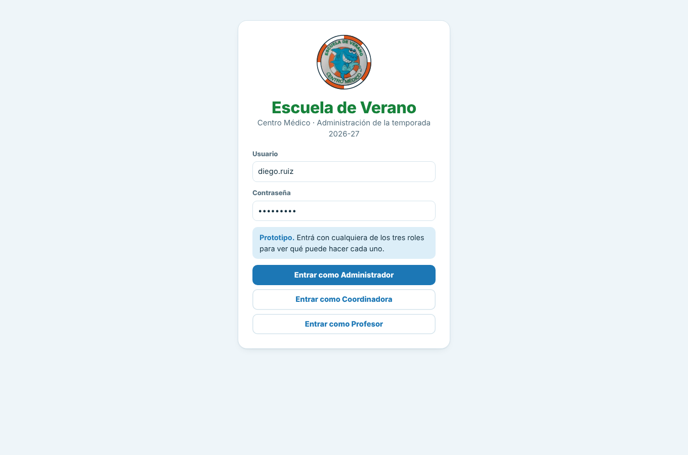

**2. Inicio.** La pantalla de entrada resume el día: cuántos alumnos hay inscriptos, cuántos están presentes, qué fichas tienen documentación pendiente y cuánto falta cobrar. Desde acá se toma asistencia de cada grupo y se entra a las familias con saldo.

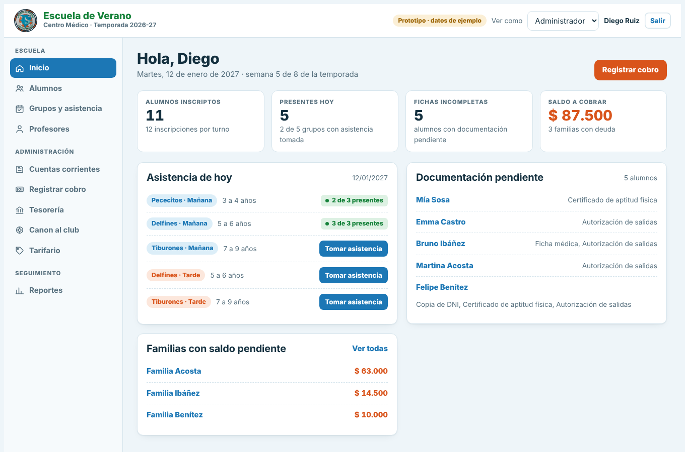

**3. Alumnos.** El listado muestra, de un vistazo, los grupos de cada chico, su familia, si le falta documentación y si tiene alguna alerta de salud. Se busca por nombre, apellido o DNI, y se filtra por grupo.

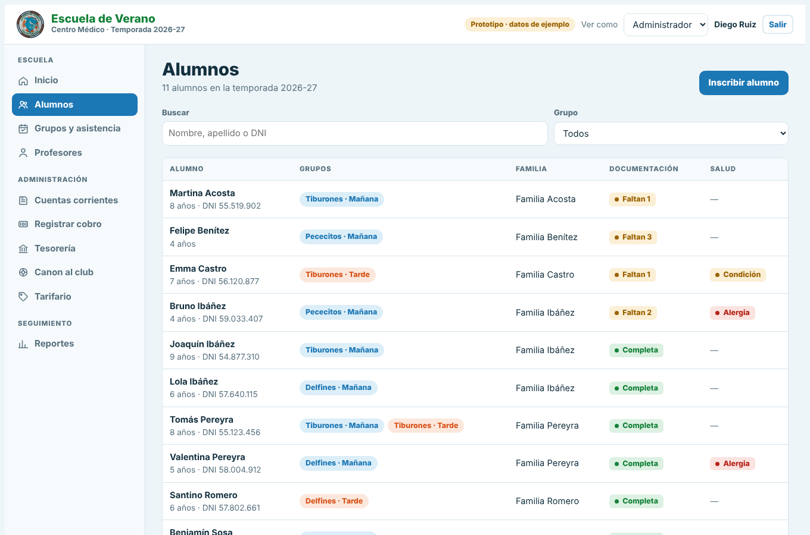

**4. Ficha del alumno.** Reúne en un solo lugar los datos personales, la familia con su categoría, las personas autorizadas a retirarlo, el checklist de documentación con lo que falta, y los datos de salud. Desde acá se cambia de grupo o se agrega una inscripción en el otro turno.

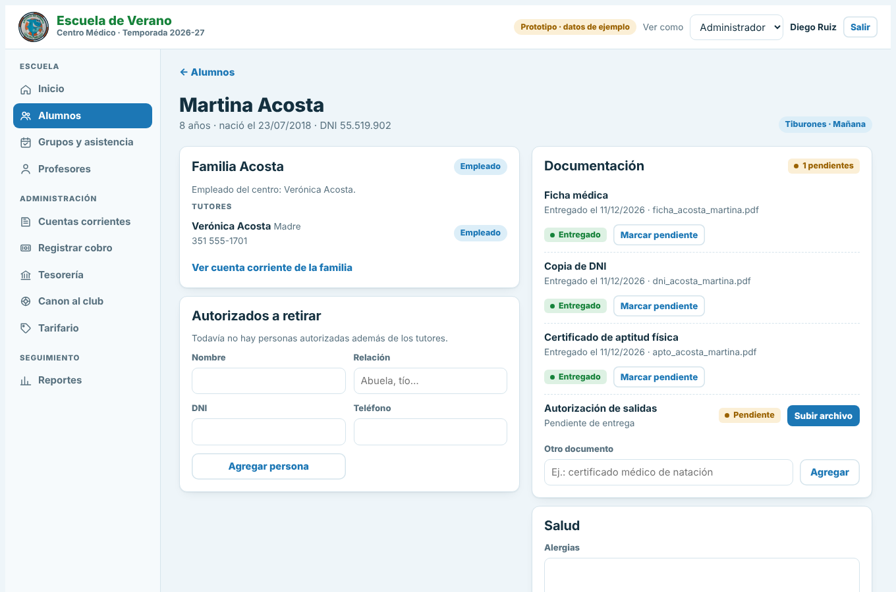

**5. Grupos y asistencia.** Cada grupo muestra su turno, su rango de edades, sus profesores y si ya se tomó asistencia hoy. El profesor ve solo sus grupos.

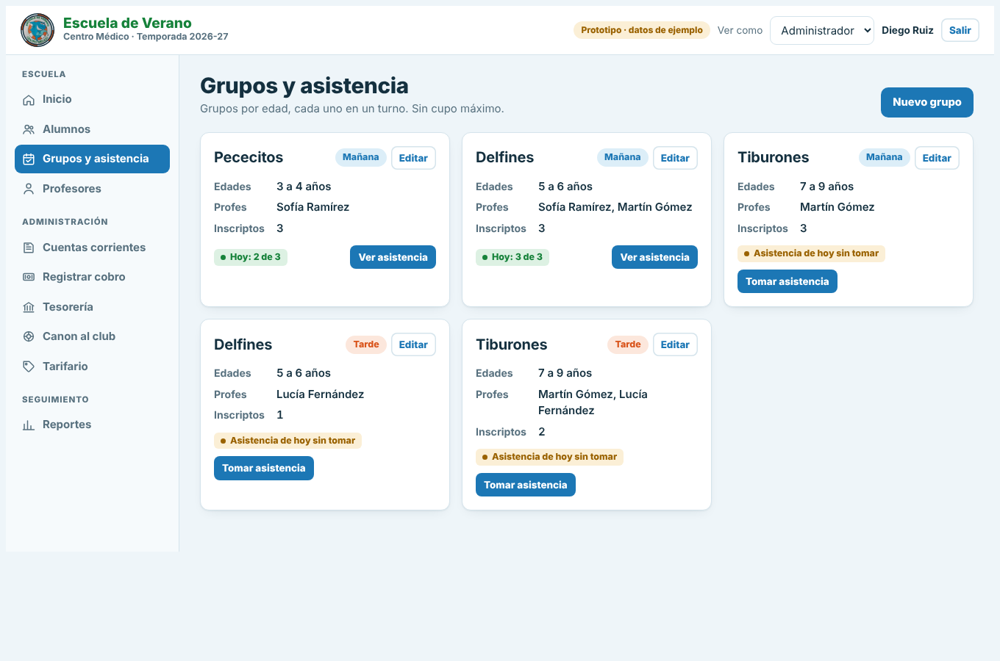

**6. Tarifario.** La configuración de la temporada: la tarifa base por turno y modalidad, y las dos tablas de descuentos. Un porcentaje para Día, Semana y Quincena, donde la cantidad de hijos no interviene, y un porcentaje del Mes por tramo de hijos. Abajo hay un simulador para probar una tarifa antes de aplicarla.

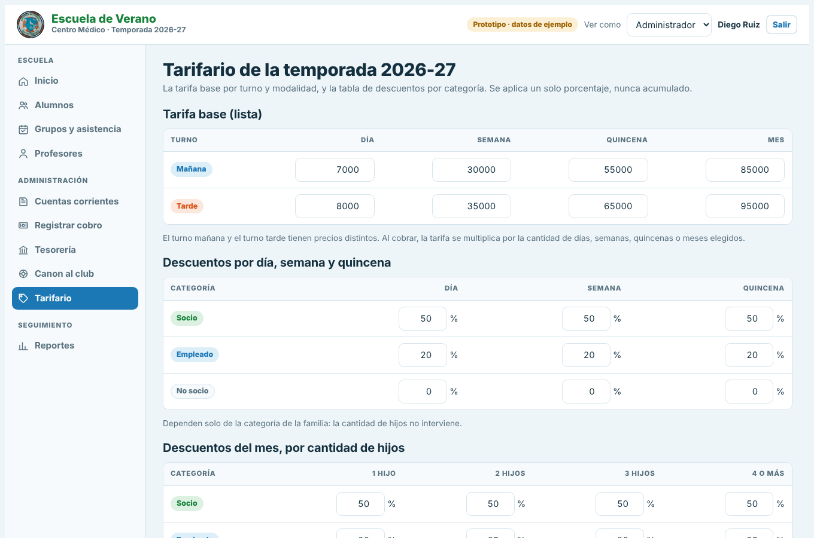

**7. Registrar cobro.** El paso donde está la lógica del sistema. Se elige el alumno, el tipo de cargo y la modalidad, y el sistema muestra el desglose completo antes de confirmar: tarifa base, de dónde sale el porcentaje aplicado y el total. Después se registra el pago, que puede ser parcial y se imputa a los cargos más antiguos.

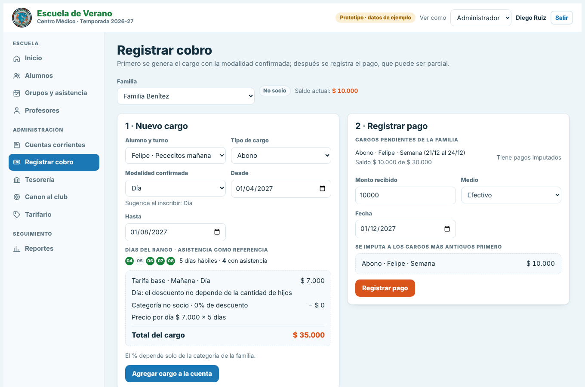

**8. Cuentas corrientes.** Una fila por familia, con lo cargado, lo pagado y el saldo. Es la base del reporte de deudas.

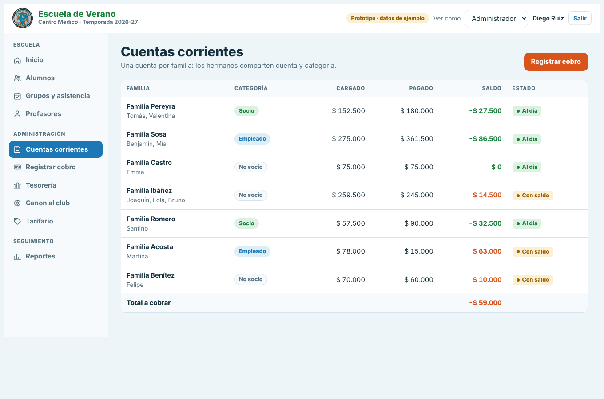

**9. Tesorería y canon.** La tesorería muestra el saldo disponible, con los ingresos que entran solos al registrar cada cobro y los egresos cargados a mano. El canon se cierra por un rango de fechas sobre lo efectivamente cobrado, con el detalle de los cobros que lo componen.

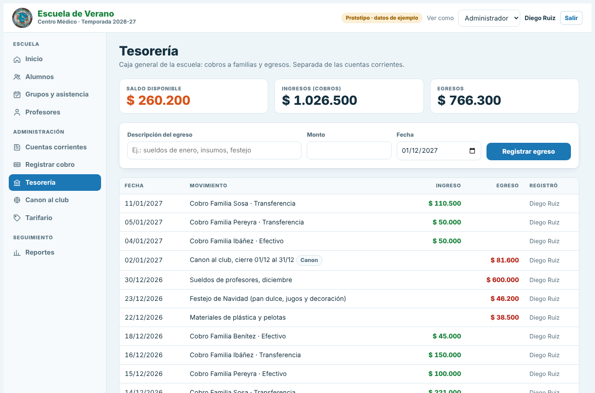

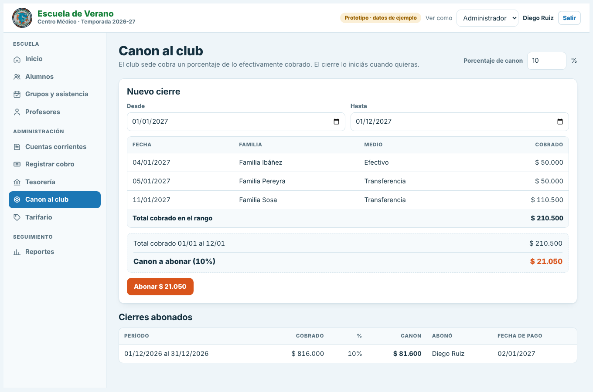

**10. En el celular.** La misma aplicación, con la navegación adaptada, para tomar asistencia o consultar una ficha desde el patio.

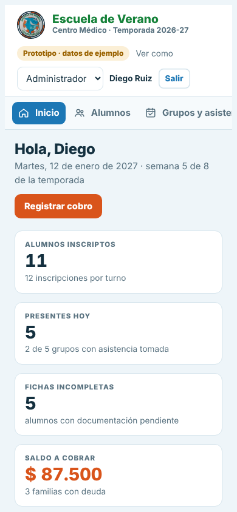

### **1.4. Instrucciones de instalación:**

Son los mismos pasos que el [`readme.md`](readme.md). Todos los comandos se corren desde la raíz con `python tasks.py <tarea>`, que funciona igual en Windows, Linux y macOS; `python tasks.py` sin argumentos lista las tareas.

**Requisitos previos:**
- Git;
- [Docker](https://www.docker.com/products/docker-desktop/), para PostgreSQL 16;
- Python 3.12 o superior;
- Node 20 o superior, con `npm`.

**1. Clonar el repositorio**

```bash
git clone https://github.com/AleBonansea/AI4Devs-finalproject.git
cd AI4Devs-finalproject
```

**2. Variables de entorno**

```bash
cp backend/.env.example backend/.env
```

Abrir `backend/.env` y reemplazar `SECRET_KEY` por una cadena larga y aleatoria: es la clave que firma los tokens de sesión. El archivo `.env` no se versiona.

| Variable | Para qué |
|---|---|
| `DATABASE_URL` | Conexión a la base de desarrollo. El ejemplo ya apunta al PostgreSQL del `docker-compose.yml`. |
| `TEST_DATABASE_URL` | Conexión a la base de pruebas. Tiene que ser distinta de la de desarrollo: los tests se niegan a correr contra ella. |
| `SECRET_KEY` | Clave para firmar los tokens. Obligatoria: sin ella la API no arranca. |
| `ACCESS_TOKEN_EXPIRE_MINUTES` | Vida del token de acceso. Opcional, 480 (8 horas) por defecto. |
| `CORS_ORIGINS` | Orígenes del frontend permitidos, separados por coma. Opcional, `http://localhost:5173` por defecto. |

`frontend/.env` no hace falta en desarrollo: Vite reenvía `/api` al backend.

**3. Dependencias, base y datos de ejemplo**

```bash
python tasks.py install   # entorno virtual del backend y npm del frontend
python tasks.py up        # PostgreSQL en Docker, con la base de desarrollo y la de pruebas
python tasks.py migrate   # alembic upgrade head
python tasks.py seed      # temporada, tarifario, grupos, usuarios y tres familias de ejemplo
```

`seed` se niega a correr sobre una base que ya tiene datos.

**4. Levantar la aplicación**, en dos terminales:

```bash
python tasks.py api        # API en http://localhost:8000, con la documentación OpenAPI en /docs
python tasks.py front-dev  # aplicación en http://localhost:5173
```

Entrar a `http://localhost:5173` con `mgarcia` (Admin), `lrodriguez` (Coordinador) o `jperez` (Profesor), todos con la contraseña `Verano2026`.

**5. Tests y comprobaciones**

```bash
python tasks.py test        # tests del backend, contra la base de pruebas
python tasks.py front-test  # tests del frontend
python tasks.py lint        # ruff check y ruff format
python tasks.py typecheck   # mypy
python tasks.py front-lint  # eslint, prettier y build
```

Los tests del backend corren contra PostgreSQL, no contra SQLite (ver [`2-arquitectura-del-sistema.md`](2-arquitectura-del-sistema.md), sección 2.6).

**Puesta en marcha real.** En producción no se corre la semilla: lo único que se crea al instalar es el **primer Admin** y la **primera temporada vigente** (Acl. 9, 10). El comando que lo hace llega con el lote 2, junto con el alta de usuarios desde la aplicación.
