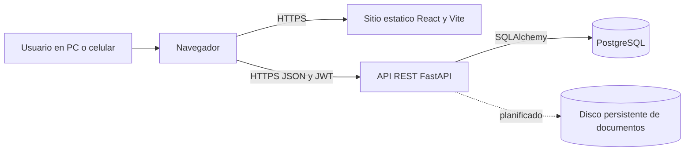
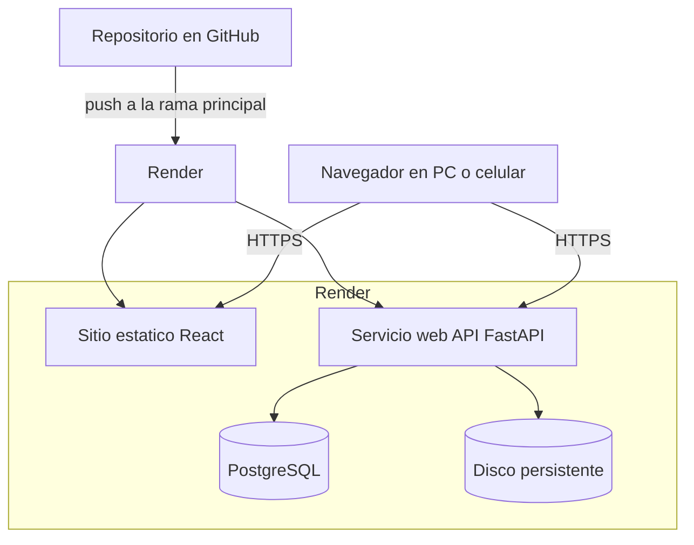

# 2. Arquitectura del Sistema

> **Fuente principal:** [`docs/architecture/documento-tecnico.md`](docs/architecture/documento-tecnico.md) (stack, despliegue en Render y seguridad). Las reglas de negocio salen de [`docs/prd/aclaraciones-cliente.md`](docs/prd/aclaraciones-cliente.md), que prevalece sobre el PRD. Donde el documento técnico y las aclaraciones difieren, se indica cuál vale.
>
> **Estado (Entrega 2):** el lote 1 está construido. La arquitectura, la estructura de ficheros y los tests que se describen acá son **los del código que está en el repositorio**. Lo que todavía no existe se marca como *planificado*: el despliegue en Render (Entrega 3), el almacenamiento de documentos y la sesión con renovación.

### **2.1. Diagrama de arquitectura:**



**Patrón.** Es una arquitectura cliente-servidor, con una **SPA** (aplicación de una sola página) que consume una **API REST**:
- el frontend es una aplicación React que se publica como sitio estático y no tiene lógica de negocio ni acceso a datos;
- el backend es un **monolito modular en capas**: rutas, servicios y acceso a datos;
- la API es **la única** que accede a PostgreSQL y, cuando llegue la documentación, al disco de documentos (documento técnico, «Despliegue en Render»).

**Por qué este stack:**
- **FastAPI + Pydantic.** La validación de datos de entrada y la especificación OpenAPI salen de los mismos modelos. El contrato no se escribe a mano: se genera desde el código en [`docs/api/openapi.json`](docs/api/openapi.json) y el CI rechaza una pull request si no está al día. Python, además, facilita testear el motor de cálculo de cargos con pytest.
- **PostgreSQL.** Las reglas críticas del dinero quedan también como constraints de la base (`CHECK` del total del cargo, FK compuesta del período, cargo repetido), no solo en el código. Ver `3-modelo-de-datos.md`.
- **React + Vite publicado como sitio estático.** Se sirve gratis con HTTPS en Render, y una sola aplicación responsive cubre la PC del Admin y el celular del profesor que toma asistencia en el patio.
- **MUI como librería de componentes, y no Mantine.** Las dos cubrían lo que hacía falta (formularios, tablas, responsive). Se eligió MUI porque tiene mucho más material de entrenamiento, así que un asistente de código genera MUI correcto con bastante más fiabilidad. En un proyecto construido con agentes, eso pesa más que las diferencias de API.
- **Monolito y no microservicios.** Hay menos de 10 usuarios y un solo dominio de negocio. Separarlo agregaría infraestructura sin ningún beneficio.

**Qué se sacrifica:**
- **FastAPI sobre Django significa programar a mano lo que Django trae hecho:**
  - la **autenticación**: login, hash, JWT, bloqueo por intentos;
  - los **permisos**: por rol y, para el Profesor, por grupo asignado;
  - las **pantallas de configuración**: no hay un panel de administración automático, así que el tarifario, los descuentos, los períodos, los usuarios y los grupos necesitan pantallas propias en React.

  El documento técnico lo asume a sabiendas, y en el backlog esas pantallas son historias propias (HU-UT-02, HU-GA-01, HU-TAR-01 a HU-TAR-03), en el lote 2. Mientras tanto, `python tasks.py seed` carga esa configuración.
- **Dos piezas para desplegar** (sitio estático y API) en lugar de una aplicación con plantillas del lado del servidor.
- **Una sola instancia de la API.** El disco persistente la impide escalar horizontalmente, y cada deploy tiene un corte breve. Con menos de 10 usuarios no es un problema (documento técnico).

### **2.2. Descripción de componentes principales:**

| Componente | Tecnología | Responsabilidad |
|---|---|---|
| **Frontend** | React 18, Vite 6 y TypeScript 5.7. Componentes de **MUI 6** y `@mui/x-data-grid`; rutas con React Router 7. | Pantallas responsive para celular y PC. Oculta lo que el rol no puede usar, pero no controla permisos. **Nunca calcula montos**: muestra los que devuelve la API (por ejemplo, el desglose de la simulación del cargo), y los formatea sin pasar por `Number`. Todas las llamadas pasan por `src/lib/api.ts`. |
| **API REST** | FastAPI 0.115 + Pydantic 2.12, servida con uvicorn. | Endpoints `/api/v1/...`, validación de entrada, reglas de negocio (motor de cálculo de cargos, saldo, pagos) y **todo** el control de acceso. Cada endpoint declara su `response_model`: nunca devuelve un modelo de la base. |
| **Acceso a datos** | SQLAlchemy 2.0 (`Mapped`, `select()`), con psycopg 3 | Modelos y consultas. Los listados del Profesor se filtran en la consulta a la base, no después. |
| **Migraciones** | Alembic 1.14 | Siete migraciones, una por cambio de esquema, revisadas a mano y probadas en los dos sentidos. Incluyen los constraints y las vistas `v_familia_etiqueta` y `v_cuenta_corriente`. |
| **Base de datos** | PostgreSQL 16 | Todos los datos de la aplicación. Una temporada vigente a la vez, y nada se borra físicamente. En local corre en Docker, con una base de desarrollo y otra de pruebas. |
| **Almacenamiento de documentos** *(planificado)* | Disco persistente de Render, adjunto al servicio web | Archivos de la documentación de los alumnos, con nombre aleatorio y fuera de cualquier carpeta pública. Llega con las historias de documentación (HU-DOC). |
| **Autenticación** | pwdlib con argon2 (hash) y PyJWT (HS256) | Token de acceso en `Authorization: Bearer`, con vencimiento configurable (8 horas por defecto). La renovación con cookie httpOnly está planificada: ver 2.5. |
| **Tests** | pytest + httpx en el backend; Vitest + Testing Library + jsdom en el frontend; Playwright (Chromium) de punta a punta | Ver 2.6. |

### **2.3. Descripción de alto nivel del proyecto y estructura de ficheros**

Es un monorepo con el backend y el frontend en carpetas hermanas, la documentación de la entrega en la raíz, y las especificaciones y el arnés de agentes en carpetas propias.

```
AI4Devs-finalproject/
├── 0-ficha-del-proyecto.md … 7-pull-requests.md   documentación de la entrega
├── readme.md                       índice y cómo levantarlo en local
├── prompts.md                      prompts usados, por sección
├── CLAUDE.md                       reglas del proyecto para el asistente
├── REVIEW.md                       qué es grave en una revisión (agente y revisor de PRs)
├── tasks.py                        lanzador de tareas: python tasks.py <tarea>
├── docker-compose.yml              PostgreSQL 16 para desarrollo y tests
├── docs/
│   ├── prd/                        PRD transcripto y aclaraciones del cliente
│   ├── product/                    backlog de historias y plan de changes
│   ├── architecture/               documento técnico
│   ├── api/openapi.json            contrato de la API, generado desde el código
│   └── previews/                   capturas del prototipo
├── openspec/
│   ├── specs/<capability>/spec.md  comportamiento vigente, un Scenario por caso
│   └── changes/archive/            los ocho changes del lote 1, con propuesta, design y tareas
├── .github/workflows/              ci.yml, openapi.yml y revisor.yml
├── .claude/
│   ├── agents/                     test-writer, implementer, ui-implementer, adversarial-reviewer
│   ├── skills/                     backend-feature, frontend-feature, commit, revisar-migracion, openspec-*
│   └── hooks/                      guardarraíles: formato, colores, datos que no salen, no borrar, no ver la implementación
├── scripts/seed.py                 datos de ejemplo
├── e2e/                            Playwright: tres recorridos de punta a punta en un navegador real
├── backend/
│   ├── app/
│   │   ├── main.py                 crea la aplicación FastAPI, monta los routers y traduce los errores
│   │   ├── core/                   config, db (sesión), security (hash y JWT), deps (usuario, rol, grupo), errores
│   │   ├── models/                 SQLAlchemy 2, uno por bloque del modelo de datos
│   │   ├── schemas/                Pydantic v2: lo que entra y sale de la API
│   │   ├── services/               reglas de negocio; calculo_cargo.py es la función pura del cálculo
│   │   ├── api/v1/                 un router por capability: auth, grupos, familias, personas, alumnos, asistencias, cargos
│   │   └── semilla.py              lo que carga python tasks.py seed
│   ├── alembic/versions/           migraciones
│   ├── tests/
│   │   ├── conftest.py             base de pruebas, aislamiento por transacción, usuarios por rol
│   │   └── functional/<capability>/  un test por Scenario de la spec
│   └── pyproject.toml
└── frontend/
    ├── src/
    │   ├── tema.ts                 el catálogo de color: único archivo con valores de color
    │   ├── lib/                    api.ts (único contacto con el backend), sesion, fechas, montos
    │   ├── components/             catálogo de piezas reutilizables: DesgloseCargo, ListaAsistencia, FormularioPago, …
    │   ├── pages/                  Ingreso, Inicio, RegistrarAlumno, TomarAsistencia, RegistrarCargo, CuentaCorriente
    │   ├── routes/                 RutaProtegida y RutaSoloAdmin
    │   └── App.tsx, main.tsx
    ├── tests/<capability>/         tests de pantalla, uno por Scenario de la spec
    └── package.json, vite.config.ts, eslint.config.js
```

**Patrones:**
- **Backend en capas:**
  - las rutas (`api/v1`) solo reciben, validan con Pydantic, aplican permisos con dependencias (`exigir_rol`, `grupo_asignado`) y delegan;
  - la lógica vive en `services`;
  - el acceso a datos está en `models`, con la sesión en `core/db.py`.

  El motor de cálculo de cargos (`services/calculo_cargo.py`) es una **función pura**: recibe tarifa base, categoría, modalidad y cantidad de hijos, y devuelve el desglose, sin tocar la base. El registro y la simulación del cargo pasan por la misma función de preparación, así que no pueden divergir.
- **El estado derivado no se guarda.** El saldo sale de la vista `v_cuenta_corriente` (cargos menos pagos) y la etiqueta de la familia de `v_familia_etiqueta`. Que un usuario esté bloqueado sale de su contador de intentos.
- **Frontend por pantallas, con catálogo:**
  - `pages` agrupa cada flujo, y toda pieza de interfaz nueva sale de `components/` o se crea ahí con nombre propio;
  - `lib/api.ts` centraliza las llamadas, adjunta el token, cierra la sesión ante un `401` y traduce los errores de la API a mensajes en castellano con su campo;
  - `routes` decide qué ve cada rol.
- **Un change, una tajada vertical.** Cada change de OpenSpec trae su modelo, su API y su pantalla, con su spec en `openspec/specs/<capability>/` y sus tests en `tests/functional/<capability>/` y `frontend/tests/<capability>/`. Spec, tests y código usan los mismos nombres de capability.

### **2.4. Infraestructura y despliegue**

**En local (hoy).** PostgreSQL 16 corre en Docker (`docker-compose.yml`) con dos bases, la de desarrollo y la de pruebas; la API y el frontend corren en la máquina con `python tasks.py api` y `python tasks.py front-dev`. Los pasos están en [`readme.md`](readme.md) y en [`1-descripcion-general-del-producto.md`](1-descripcion-general-del-producto.md), sección 1.4.

**Integración continua (hoy).** Tres workflows de GitHub Actions corren en cada pull request:

| Workflow | Qué hace |
|---|---|
| [`ci.yml`](.github/workflows/ci.yml) | Backend: `ruff`, `mypy` estricto, migraciones de ida, vuelta e ida (`upgrade head`, `downgrade -1`, `upgrade head`) y `pytest` contra un PostgreSQL 16 de servicio. Frontend: `eslint`, `prettier`, build de TypeScript y Vitest, con el huso horario de Argentina fijado. Corre con los mismos comandos de `tasks.py` que se usan en local. |
| [`openapi.yml`](.github/workflows/openapi.yml) | Regenera el contrato desde el código y falla si no coincide con `docs/api/openapi.json`. |
| [`revisor.yml`](.github/workflows/revisor.yml) | Revisión automática del diff con `claude-code-action`, siguiendo `REVIEW.md`. Publica el informe como comentario en la PR. Ver «Mantenimiento» al final de esta sección. |

**Producción (planificado, Entrega 3).** Todo corre en **una sola cuenta de Render** a nombre del cliente, con Ale como miembro con acceso de administración (documento técnico).



| Componente en Render | Plan | Por qué |
|---|---|---|
| **Sitio estático** (frontend) | Gratis | Incluye dominio propio y HTTPS automático. |
| **Servicio web** (API) | Pago | El plan gratis se apaga a los 15 minutos sin uso y tarda cerca de un minuto en despertar. |
| **PostgreSQL** | Pago | El plan gratis vence a los 30 días y no tiene backups. El pago permite recuperar la base a cualquier momento de los últimos 3 días (workspace Hobby) o 7 (Pro), y guarda los exports 7 días. |
| **Disco persistente** | Adjunto al servicio web | Copia automática cada 24 horas, guardada al menos 7 días. Obliga a una sola instancia de la API. |

**Proceso de despliegue:**
1. Cada push a la rama principal de GitHub dispara el deploy automático en Render (documento técnico).
2. Render construye el sitio estático (build de Vite) y el servicio web (instalación de dependencias de Python).
3. `alembic upgrade head` corre como comando previo al arranque del servicio web (pre-deploy command de Render), para que la API nunca arranque con un esquema viejo. Que cada migración sea reversible ya lo comprueba el CI.
4. El servicio web arranca. Mientras tanto hay un corte breve, aceptable con menos de 10 usuarios.

**Puesta en marcha.** Al instalar el sistema se crean el primer Admin y la primera temporada vigente (Acl. 9, 10). Es una tarea de instalación, no una historia de usuario; su comando llega con el lote 2. En producción **no se corre la semilla**.

**Fuera de temporada (marzo a noviembre).** El documento técnico ofrece tres opciones y recomienda la A: suspender el servidor y dejar la base prendida. Es la que coincide con la decisión del cliente de **conservar todo** entre temporadas (Acl. 10). La recomendación original del documento técnico de borrar los archivos de documentación al cerrar la temporada **no se adopta**, porque Acl. 10 establece que no se borra nada.

**Pendientes técnicos** (documento técnico):
- confirmar la opción de fuera de temporada;
- plan del workspace (Hobby o Pro, que define si la recuperación de la base cubre 3 o 7 días) y si esa retención alcanza;
- región;
- dominio, del que dependen la cookie de renovación y CORS;
- límite del tamaño del cuerpo de la petición en Render;
- que la semilla no pueda escribir en la base de producción (antes de crear esa base).

La librería de UI, que figuraba como pendiente en la Entrega 1, quedó resuelta: MUI (ver 2.1).

#### Mantenimiento: revisión de pull requests y documentación viva

El ciclo de vida no termina cuando el código pasa los tests. Dos piezas, en uso desde el primer change del lote 1, cubren lo que pasa después:

**Revisión de cada pull request, en dos capas de IA.**
- **Antes de abrir la PR**, el subagente `adversarial-reviewer` ([`.claude/agents/adversarial-reviewer.md`](.claude/agents/adversarial-reviewer.md)) revisa la change terminada buscando lo que está mal, no lo que está bien. Corre una sola vez por change. En el lote 1 encontró, entre otros, un `500` en el login público ante un carácter mal formado, una carrera en el rechazo de cargos repetidos y un test de la fecha de hoy que no podía fallar ([`7-pull-requests.md`](7-pull-requests.md)).
- **En cada PR**, el workflow `revisor.yml` revisa el diff contra la rama base y publica el informe como comentario. Desde la #3, todas las PRs del repositorio tienen su informe.
- **Las dos capas leen el mismo criterio**, [`REVIEW.md`](REVIEW.md): solo cuatro cosas son graves (el dinero sale mal, alguien ve lo que no le toca, se destruye algo, el verde no significa nada), y hay un tope de sugerencias menores. Sin eso, un revisor automático llena la PR de estilo y lo grave se pierde. Cuando una revisión marcó un falso positivo, se corrigió la regla en `REVIEW.md`, no se ignoró el comentario: así la revisión siguiente no lo repite.
- El revisor corre con Sonnet y un tope de turnos, de modo que cada pase cuesta centavos. Solo corre en PRs dentro de este fork, porque un fork no recibe los secretos: por eso las PRs de trabajo van de `feat/*` hacia la rama de entrega, y no hacia el repositorio de LIDR.

**Documentación viva.**
- **Las specs de OpenSpec son la documentación del comportamiento, y no se separan del código.** Cada change escribe un delta de spec antes del código; los tests se escriben desde esos Scenarios; y al archivar el change, `/openspec-archive-change` funde el delta en [`openspec/specs/<capability>/spec.md`](openspec/specs/). Hoy hay 12 specs vigentes, y los tests se escriben uno por Scenario: si alguien cambia el comportamiento sin cambiar la spec, falla el test de ese Scenario.
- **El contrato de la API se regenera y se comprueba** en cada PR (`openapi.yml`), así que no puede quedar desactualizado respecto del código.
- **Las decisiones quedan con su porqué.** El `design.md` de cada change archivado registra las alternativas descartadas y los riesgos aceptados; los desvíos respecto de la documentación de la Entrega 1 (por ejemplo, la simulación como endpoint propio) están justificados ahí y resumidos en `4-especificaciones-de-la-api.md`.
- **Las reglas del proyecto viven en el repo**, en `CLAUDE.md`, `REVIEW.md` y las skills de `.claude/skills/`, y se corrigen cuando un error las muestra incompletas. Ejemplo: tras encontrar un `conftest.py` que dejaba la suite en verde con el bloqueo roto, la skill `backend-feature` pasó a congelar `conftest.py` junto con los tests ([`prompts.md`](prompts.md), sección 7).

### **2.5. Seguridad**

Principio general: **todo control de acceso se hace en la API**. El frontend solo oculta lo que el usuario no puede usar (documento técnico, «Autenticación, permisos y archivos privados»).

**Contraseñas y sesión**
- Las contraseñas se guardan con hash argon2 (pwdlib). Nunca se guardan ni se registran en texto. El login compara contra un hash ficticio cuando el usuario no existe, para que el tiempo de respuesta no revele qué usuarios existen.
- **Hoy:** el login devuelve un token de acceso JWT que vence a las 8 horas (`access_token_expire_minutes`). El frontend lo guarda en `localStorage` y lo manda en `Authorization: Bearer`. La API **relee el usuario en cada petición**, así que desactivarlo o bloquearlo corta su sesión al instante, aunque el token siga vigente.
- **Planificado:** el token de renovación en una cookie httpOnly y el vencimiento por inactividad (30 minutos en computadora y más en el celular del profesor) que pide el documento técnico. Dependen del dominio propio: el sitio estático y la API son dos servicios distintos de Render, y con los dominios por defecto esa cookie sería de terceros. Se resuelven publicando la API en un subdominio (`app.<dominio>` y `api.<dominio>`). El riesgo de tener el token en `localStorage` mientras tanto (un XSS se lo lleva) está asumido en el design del change `pantalla-de-ingreso`; lo mitigan que React escapa el contenido y que no hay HTML de terceros.
- Cada persona tiene su propio usuario, sin cuentas compartidas (Acl. 11).
- Los usuarios desactivados no pueden ingresar, pero se conservan para las referencias de quién cobró, anuló o abonó el canon.
- **Bloqueo:** al quinto intento fallido seguido el usuario queda bloqueado, hasta que un Admin le blanquee la contraseña (Acl. 9). Está construido en HU-UT-01. El riesgo de que cualquiera bloquee una cuenta desde internet con cinco intentos, con usernames predecibles, está registrado como pregunta abierta en `aclaraciones-cliente.md`; su mitigación (límite por IP o desbloqueo automático) es HU-UT-08, en el lote 2, y **bloquea la salida a producción**.
- **Cambio de contraseña obligatorio:** mientras `debe_cambiar_password` está activo, la API rechaza todo salvo `GET /auth/yo`. El endpoint y la pantalla del cambio (HU-UT-06), el blanqueo (HU-UT-07) y la validación de la contraseña nueva son del lote 2.

**Permisos**
- Cada endpoint declara con una **dependencia de FastAPI** (`exigir_rol`) qué roles pueden usarlo: Admin, Coordinador o Profesor.
- Para el Profesor, una **segunda dependencia** (`grupo_asignado`) comprueba que el grupo pertenezca a sus grupos asignados (`grupo_profesor`). Un grupo ajeno y uno inexistente dan el mismo `403`, para no revelar cuáles existen.
- **Los listados se filtran en la consulta a la base, no después**: un Profesor nunca recibe filas de otros grupos.
- **Toda respuesta pasa por un esquema de Pydantic** (`response_model`). Es lo que impide que se filtren el hash de la contraseña o un dato que no corresponde.
- **Lo contable es solo del Admin:** cargos, pagos y cuenta corriente responden `403` al Coordinador y al Profesor, antes de leer nada.
- **Datos sensibles** (Acl. 11): el Profesor verá alergias y condiciones médicas solo de los alumnos de sus grupos, y de los hijos de otros grupos solo los datos de familia y las personas autorizadas. Las columnas médicas y el consentimiento llegan con sus historias (HU-AF-06/07); hoy la base no guarda datos médicos.

**Archivos privados** *(planificado, con las historias de documentación)*
- Los documentos se guardan en el disco del servidor, **fuera de cualquier carpeta pública**, con un **nombre aleatorio**.
- Se descargan **solo por un endpoint** que valida el permiso sobre ese alumno antes de entregar el archivo. Nunca hay URLs públicas.
- Al subir un archivo se valida el tipo (PDF, JPG o PNG) y el tamaño. **Límite: 5 MB** (Acl. 11).

**Datos de menores** (Acl. 11)
- **Consentimiento:** se registra que el tutor autorizó la carga de datos médicos (Ley 25.326). La base no aceptará datos médicos sin ese consentimiento (`CHECK` en `alumno`).
- **Trazabilidad:** cada alta, reemplazo o edición de un documento queda en `documento_evento`, con el usuario y la fecha.
- **Retención:** no se borra nada (Acl. 10), así que los datos sensibles quedan guardados por tiempo indefinido. Eso hace que los controles anteriores sean más importantes.
- **En el desarrollo:** dos hooks del arnés cortan los comandos que sacarían datos reales hacia afuera (un volcado de la base, el `.env`) o que destruirían datos (`DROP`, `downgrade base`). Son una red contra el descuido, no un candado; el candado es que las credenciales de producción no vivan en la máquina de desarrollo.
- **Antes de producción:** hace falta una consulta legal para confirmar si la base debe inscribirse ante la AAIP.

**Transporte y entrada de datos**
- **HTTPS** en el sitio estático (automático en Render) y en la API.
- Toda entrada pasa por **Pydantic**, que valida tipos, longitudes y enumerados, y rechaza campos de más (`extra="forbid"`). Las consultas usan SQLAlchemy con parámetros, nunca SQL armado con texto del usuario.
- Los rechazos `422` **no repiten lo recibido**: el mensaje dice qué está mal sin devolver el valor, para no reflejar contenido del atacante.
- **El precio de un cargo nunca viene del cliente.** El cuerpo de `POST /cargos` no tiene ningún campo de dinero; el monto lo calcula la API. El monto de un pago sí viene del cuerpo, porque es lo que la familia entregó, y la API lo acota: positivo, hasta dos decimales y nunca más que el saldo del cargo.
- CORS se limita al origen del frontend (`cors_origins`).

### **2.6. Tests**

**634 tests automatizados**: 467 del backend, 164 del frontend y 3 de punta a punta. Corren en cada pull request y en local con `python tasks.py test`, `python tasks.py front-test` y `python tasks.py e2e`.

**Foco: el cálculo de cargos y descuentos.** Es donde está la lógica de negocio que mueve dinero, y donde un error pasa desapercibido hasta que un cliente reclama. Es la capability con más tests: 102 de los 467 del backend.

**Cómo se escriben.** Cada Scenario de una spec tiene su test, y el test lo escribe un subagente (`test-writer`) que **no puede leer la implementación**: un hook le corta la lectura de `backend/app/` y `frontend/src/`. Los tests se ven fallar por el motivo correcto, se congelan por hash y recién entonces otro subagente (`implementer`) escribe el código, sin poder tocarlos. Ver [`prompts.md`](prompts.md), sección 7.

| Nivel | Qué se prueba | Cómo | Tests |
|---|---|---|---|
| **Funcional del backend** | Cada endpoint, por Scenario de la spec: camino feliz, rechazos, permisos por rol y por grupo | Cliente de pruebas de FastAPI contra PostgreSQL real, en `backend/tests/functional/<capability>/` | 451 |
| **Cálculo de cargos** | `services/calculo_cargo.py` como función pura: un único % sin acumular, tramo de hijos solo en el Mes, tramo «4 o más» aplicado a todos, monto fijo, redondeo con `Decimal` igual al de PostgreSQL | Tablas de casos, sin base; y los mismos casos por la API | Dentro de los 102 de `cargos` |
| **Permisos** | Cada endpoint con cada rol: `403` para los roles sin permiso, el Profesor fuera de sus grupos, y que nada quede escrito cuando se rechaza | Archivos `test_permisos*.py` de cada capability | Dentro de los 451 |
| **Constraints de la base** | `CHECK`, FK compuestas, únicos y vistas | Insertar filas inválidas y esperar `IntegrityError` | Dentro de los 451, más 16 de forma del esquema y salud |
| **Migraciones** | Alembic | `upgrade head`, `downgrade -1` y `upgrade head` en el CI, en cada PR | — |
| **Pantallas del frontend** | Cada pantalla, por Scenario de la spec: qué muestra, qué manda a la API, cómo muestra los errores por campo, qué ve cada rol | Vitest + Testing Library sobre jsdom, con la API simulada en `fetch`, en `frontend/tests/<capability>/` | 124, más 3 de la preparación |
| **Formato del frontend** | `lib/fechas.ts` y `lib/montos.ts`: fechas dd/mm/aaaa y montos como `$ 4.462,50` sin pasar por `float` | Vitest | 37 |
| **Punta a punta** | Tres recorridos en un navegador real: alta, cargo y pago hasta el saldo en cero; un Profesor que no llega a la cuenta corriente ni por la pantalla ni por la API; un token inválido que vuelve al ingreso | Playwright sobre el build servido y la API en otro origen, con CORS, contra una base `escuelita_e2e` recreada y sembrada en cada corrida, en `e2e/tests/` | 3 |

Por capability, en el backend: `cargos` 102, `asistencia` 45, `familias` 45, `auth` 41, `alumnos` 39, `pagos` 35, `errores-de-la-api` 30, `tarifario` 30, `grupos` 28, `semilla` 23, `cuenta-corriente` 16, `tesoreria` 13, `temporadas` 4, y 16 de esquema y salud. En el frontend: `auth` 49, `alumnos` 19, `cuenta-corriente` 17, `asistencia` 13, `cargos` 13, `navegacion` 13, `lib` 37 y 3 de la preparación. De punta a punta: 3, en `e2e/tests/`.

**Decisiones:**
- **PostgreSQL real en los tests, no SQLite.** SQLite no evalúa igual los `CHECK` ni las FK compuestas, y esas reglas son parte del diseño. Un test lo comprueba (`test_la_base_de_pruebas_es_postgres`), y `conftest.py` se niega a correr contra la base de desarrollo.
- **Aislamiento por transacción.** Cada test corre dentro de una transacción que se revierte, y la API recibe su propia sesión sobre la misma conexión. Así un servicio que olvida confirmar la transacción falla el test, en lugar de pasar porque comparte la sesión con él.
- **Datos de los criterios de aceptación.** Los tests usan los mismos montos y porcentajes que los Scenarios de las specs, así que criterios y tests no se separan.
- **La API vieja de SQLAlchemy falla el test.** `pytest` convierte en error los avisos de `session.query` y `Column`, para que el stack no retroceda a la API 1.x.
- **Un guardarraíl que nunca se vio fallar no está probado.** Ante un test sospechoso se rompe el código a propósito y se comprueba que el test se pone en rojo. Así se encontró, por ejemplo, que el test de la fecha de hoy no podía fallar a las 10 de la mañana, y se fijó el huso de Argentina en Vite, en `tasks.py` y en el CI.
- **Pocos tests de punta a punta, elegidos.** Hasta el change `pruebas-e2e` no había ninguno: las pantallas se probaban contra una API simulada, la API contra la base real, y el recorrido completo se verificaba a mano. Eso dejaba sin probar la costura entre las dos (una respuesta real que se separa de la fingida pasa las dos suites) y la configuración de producción, con el build estático y la API en otro origen. Ahora hay tres, los de mayor costo si se rompen: el que mueve dinero, el que protege lo contable y el que corta la sesión. El resto sigue cubierto por Scenario en las suites de pantalla y de API, que son más rápidas y dicen con precisión qué se rompió.
  - **Reglas:** un worker, cero reintentos, sin esperas fijas (`python tasks.py e2e` corta si un test usa `waitForTimeout` o `setTimeout`) y el trace guardado solo cuando un test falla.
  - **Base propia:** `escuelita_e2e`, recreada, migrada y sembrada en cada corrida. La tarea se niega a borrar una base que no se llame exactamente así o que no sea local.
  - **Cada test se vio fallar** con un sabotaje temporal del código de producción (ver el design del change `pruebas-e2e`).
  - **Lo que sigue siendo a mano:** la recorrida en celular, siguiendo los Scenarios de pantalla de cada spec. Los E2E corren solo en Chromium de escritorio.
