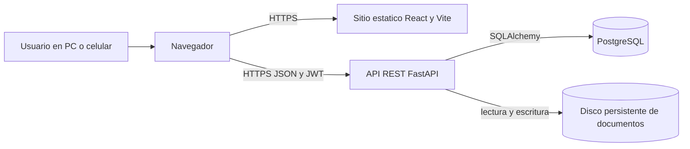
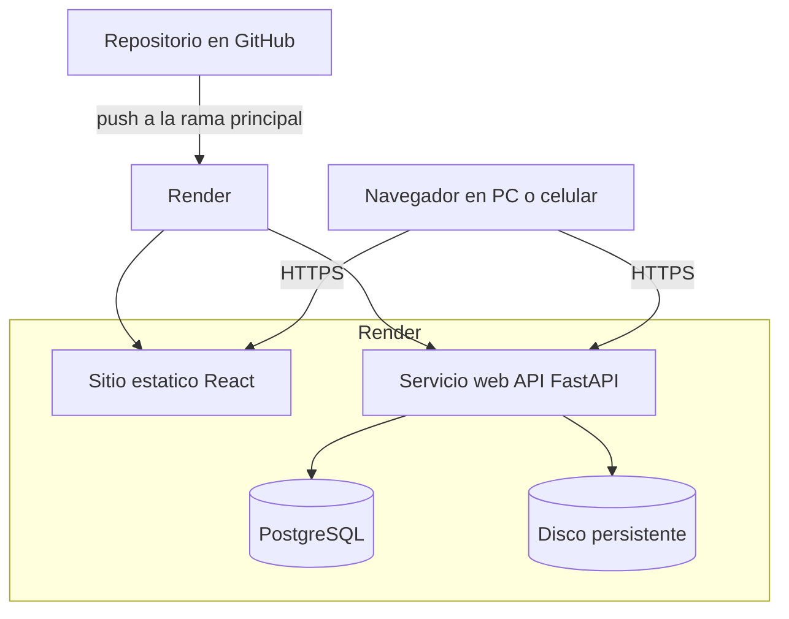

# 2. Arquitectura del Sistema

> **Fuente principal:** [`docs/architecture/documento-tecnico.md`](docs/architecture/documento-tecnico.md) (stack, despliegue en Render y seguridad). Las reglas de negocio salen de [`docs/prd/aclaraciones-cliente.md`](docs/prd/aclaraciones-cliente.md), que prevalece sobre el PRD. Donde el documento técnico y las aclaraciones difieren, se indica cuál vale.
>
> **Estado:** todavía no hay código. La arquitectura, la estructura de ficheros y los tests que se describen acá son **lo planificado** para la Entrega 1 y las siguientes.

### **2.1. Diagrama de arquitectura:**



**Patrón.** Es una arquitectura cliente-servidor, con una **SPA** (aplicación de una sola página) que consume una **API REST**:
- el frontend es una aplicación React que se publica como sitio estático y no tiene lógica de negocio ni acceso a datos;
- el backend es un **monolito modular en capas**: rutas, servicios y acceso a datos;
- la API es **la única** que accede a PostgreSQL y al disco de documentos (documento técnico, «Despliegue en Render»).

**Por qué este stack:**
- **FastAPI + Pydantic.** La validación de datos de entrada y la especificación OpenAPI salen de los mismos modelos, así que la API documentada en `4-especificaciones-de-la-api.md` y la implementada no se separan. Python, además, facilita testear el motor de cálculo de cargos con pytest.
- **PostgreSQL.** Las reglas críticas del dinero quedan también como constraints de la base (`CHECK` del total del cargo, FK compuesta del período, cierres de canon inmutables), no solo en el código. Ver `3-modelo-de-datos.md`.
- **React + Vite publicado como sitio estático.** Se sirve gratis con HTTPS en Render, y una sola aplicación responsive cubre la PC del Admin y el celular del profesor que toma asistencia en el patio.
- **Monolito y no microservicios.** Hay menos de 10 usuarios y un solo dominio de negocio. Separarlo agregaría infraestructura sin ningún beneficio.

**Qué se sacrifica:**
- **FastAPI sobre Django significa programar a mano lo que Django trae hecho:**
  - la **autenticación**: login, hash, JWT con renovación, vencimiento de sesión;
  - los **permisos**: por rol y, para el Profesor, por grupo asignado;
  - las **pantallas de configuración**: no hay un panel de administración automático, así que el tarifario, los descuentos, los períodos, los usuarios y los grupos necesitan pantallas propias en React.

  El documento técnico lo asume a sabiendas, y en el backlog esas pantallas son historias propias (HU-UT-02, HU-GA-01, HU-TAR-01 a HU-TAR-03).
- **Dos piezas para desplegar** (sitio estático y API) en lugar de una aplicación con plantillas del lado del servidor.
- **Una sola instancia de la API.** El disco persistente la impide escalar horizontalmente, y cada deploy tiene un corte breve. Con menos de 10 usuarios no es un problema (documento técnico).

### **2.2. Descripción de componentes principales:**

| Componente | Tecnología | Responsabilidad |
|---|---|---|
| **Frontend** | React + Vite. Componentes de UI: MUI o Mantine, pendiente de elegir. | Pantallas responsive para celular y PC. Oculta lo que el rol no puede usar, pero no controla permisos. Nunca calcula montos: muestra los que calcula la API (por ejemplo, la simulación del cargo). |
| **API REST** | FastAPI + Pydantic v2, servida con un servidor ASGI. | Endpoints `/api/v1/...`, validación de entrada, reglas de negocio (motor de cálculo de cargos, anulaciones, cierre de canon) y **todo** el control de acceso. |
| **Acceso a datos** | SQLAlchemy 2 (o SQLModel) | Modelos y consultas. Los listados del Profesor se filtran en la consulta a la base, no después. |
| **Migraciones** | Alembic | Cambios de esquema versionados, incluidos los constraints y las vistas (`v_cuenta_corriente`, `v_familia_etiqueta`, …). |
| **Base de datos** | PostgreSQL | Todos los datos de la aplicación. Una temporada vigente a la vez, y nada se borra físicamente. |
| **Almacenamiento de documentos** | Disco persistente de Render, adjunto al servicio web | Archivos de la documentación de los alumnos, con nombre aleatorio y fuera de cualquier carpeta pública. |
| **Autenticación** | pwdlib con argon2 (hash) y JWT | Token de acceso de vida corta y token de renovación en una cookie httpOnly. |
| **Tests** | pytest | Ver 2.6. |

### **2.3. Descripción de alto nivel del proyecto y estructura de ficheros**

> **Estructura planificada.** Todavía no hay código en el repositorio: esta es la estructura que se va a crear al empezar el desarrollo. La Entrega 1 es solo documentación.

Es un monorepo con el backend y el frontend en carpetas hermanas, y la documentación de la entrega en la raíz.

```
AI4Devs-finalproject/
├── 0-ficha-del-proyecto.md … 7-pull-requests.md   documentación de la entrega
├── readme.md                                     índice
├── prompts.md                                    prompts usados
├── CLAUDE.md                                     reglas del proyecto para el asistente
├── docs/
│   ├── prd/              PRD transcripto y aclaraciones del cliente
│   ├── product/          backlog de historias
│   └── architecture/     documento técnico
├── backend/
│   ├── app/
│   │   ├── main.py       crea la aplicación FastAPI y monta los routers
│   │   ├── core/         configuración, hash de contraseñas, JWT
│   │   ├── db/           sesión de SQLAlchemy
│   │   ├── models/       modelos de SQLAlchemy, uno por entidad del modelo de datos
│   │   ├── schemas/      modelos Pydantic de entrada y salida
│   │   ├── services/     reglas de negocio, por ejemplo calculo_cargo.py y cargos.py
│   │   └── api/
│   │       ├── deps.py   dependencias: sesión, usuario actual, rol, grupo del profesor
│   │       └── v1/       un router por recurso: alumnos.py, asistencias.py, cargos.py
│   ├── alembic/
│   │   └── versions/     migraciones
│   ├── tests/
│   │   ├── unit/         motor de cálculo y reglas puras, sin base
│   │   ├── integration/  endpoints y constraints contra PostgreSQL
│   │   └── conftest.py   base de pruebas, usuarios por rol, datos de ejemplo
│   └── pyproject.toml
└── frontend/
    ├── src/
    │   ├── api/          cliente HTTP y tipos de las respuestas de la API
    │   ├── auth/         login, sesión y guardas de ruta por rol
    │   ├── pages/        una carpeta por pantalla: alumnos, asistencia, cargos, …
    │   ├── components/   componentes reutilizables
    │   └── main          punto de entrada de React
    ├── index.html
    ├── vite.config
    └── package.json
```

**Patrones:**
- **Backend en capas:**
  - las rutas (`api/v1`) solo reciben, validan con Pydantic, aplican permisos con dependencias y delegan;
  - la lógica vive en `services`;
  - el acceso a datos está en `models` y `db`.

  El motor de cálculo de cargos (`services/calculo_cargo.py`) es una función pura, sin base de datos, para poder testearlo con tablas de casos (ver `6-tickets-de-trabajo.md`, TK-02).
- **Frontend por pantallas:**
  - `pages` agrupa cada flujo;
  - `api` centraliza las llamadas y la forma de manejar los errores `401`, `403`, `409` y `422`;
  - `auth` decide qué rutas ve cada rol.

### **2.4. Infraestructura y despliegue**

Todo corre en **una sola cuenta de Render** a nombre del cliente, con Ale como miembro con acceso de administración (documento técnico).



| Componente en Render | Plan | Por qué |
|---|---|---|
| **Sitio estático** (frontend) | Gratis | Incluye dominio propio y HTTPS automático. |
| **Servicio web** (API) | Pago | El plan gratis se apaga a los 15 minutos sin uso y tarda cerca de un minuto en despertar. |
| **PostgreSQL** | Pago | El plan gratis vence a los 30 días y no tiene backups. El pago permite recuperar la base a cualquier momento de los últimos 3 días (workspace Hobby) o 7 (Pro), y guarda los exports 7 días. |
| **Disco persistente** | Adjunto al servicio web | Copia automática cada 24 horas, guardada al menos 7 días. Obliga a una sola instancia de la API. |

**Proceso de despliegue:**
1. Cada push a la rama principal de GitHub dispara el deploy automático en Render (documento técnico).
2. Render construye el sitio estático (build de Vite) y el servicio web (instalación de dependencias de Python).
3. **Migraciones (propuesta).** El documento técnico no define cuándo corren las migraciones. Se propone correr `alembic upgrade head` como comando previo al arranque del servicio web, para que la API nunca arranque con un esquema viejo.
4. El servicio web arranca. Mientras tanto hay un corte breve, aceptable con menos de 10 usuarios.

**Puesta en marcha.** Al instalar el sistema se crean el primer Admin y la primera temporada vigente (Acl. 9, 10). Es una tarea de instalación, no una historia de usuario.

**Fuera de temporada (marzo a noviembre).** El documento técnico ofrece tres opciones y recomienda la A: suspender el servidor y dejar la base prendida. Es la que coincide con la decisión del cliente de **conservar todo** entre temporadas (Acl. 10). La recomendación del documento técnico de borrar los archivos de documentación al cerrar la temporada **no se adopta**, porque Acl. 10 establece que no se borra nada.

**Pendientes técnicos** (documento técnico):
- confirmar la opción de fuera de temporada;
- plan del workspace (Hobby o Pro, que define si la recuperación de la base cubre 3 o 7 días) y si esa retención alcanza;
- región;
- dominio;
- librería de UI.

### **2.5. Seguridad**

Principio general: **todo control de acceso se hace en la API**. El frontend solo oculta lo que el usuario no puede usar (documento técnico, «Autenticación, permisos y archivos privados»).

**Contraseñas y sesión**
- Las contraseñas se guardan con hash argon2 (pwdlib). Nunca se guardan ni se registran en texto.
- El login devuelve un **token de acceso de vida corta** y un **token de renovación en una cookie httpOnly**, que no se puede leer desde JavaScript. Mientras hay actividad la sesión se renueva; sin actividad vence: 30 minutos en computadora y más en el celular del profesor (a ajustar).
- Cada persona tiene su propio usuario, sin cuentas compartidas (Acl. 11).
- Los usuarios desactivados no pueden ingresar, pero se conservan para las referencias de quién cobró, anuló o abonó el canon.
- El documento técnico prevé además:
  - el cambio de contraseña obligatorio al crear o blanquear un usuario (`debe_cambiar_password`);
  - la validación de la contraseña nueva (mínimo 8 caracteres, letra y número, distinta del usuario y de la anterior);
  - el bloqueo tras 5 intentos fallidos seguidos;
  - la regla del nombre de usuario.

  Estas medidas las define la sección «Acceso al sistema y usuarios» del PRD vigente (registrada en Acl. 9), y tienen historias en el backlog. El cambio obligatorio (HU-UT-06) y el blanqueo por un Admin (HU-UT-07) están en el lote de la Entrega 1. El bloqueo tras 5 intentos (HU-UT-08) es Should-have. Sus campos están en `usuario` (`3-modelo-de-datos.md`).

**Permisos**
- Cada endpoint declara con una **dependencia de FastAPI** qué roles pueden usarlo: Admin, Coordinador o Profesor.
- Para el Profesor, una **segunda dependencia** comprueba que el grupo o el alumno pertenezca a sus grupos asignados (`grupo_profesor`).
- **Los listados se filtran en la consulta a la base, no después**: un Profesor nunca recibe datos de otros grupos.
- **Datos sensibles** (Acl. 11): el Profesor ve alergias y condiciones médicas solo de los alumnos de sus grupos. De los hermanos que están en otros grupos ve los datos de familia y las personas autorizadas, pero no los datos médicos ni los documentos.

**Archivos privados**
- Los documentos se guardan en el disco del servidor, **fuera de cualquier carpeta pública**, con un **nombre aleatorio**.
- Se descargan **solo por un endpoint** que valida el permiso sobre ese alumno antes de entregar el archivo. Nunca hay URLs públicas.
- Al subir un archivo se valida el tipo (PDF, JPG o PNG) y el tamaño. **Límite: 5 MB**, que es lo que decidió el cliente (Acl. 11) y prevalece. El documento técnico dice 10 MB y hay que alinearlo.

**Datos de menores** (Acl. 11)
- **Consentimiento:** se registra que el tutor autorizó la carga de datos médicos (Ley 25.326). La base no acepta datos médicos sin ese consentimiento (`CHECK` en `alumno`).
- **Trazabilidad:** cada alta, reemplazo o edición de un documento queda en `documento_evento`, con el usuario y la fecha. Es un historial que no se puede modificar.
- **Retención:** no se borra nada (Acl. 10), así que los datos sensibles quedan guardados por tiempo indefinido. Eso hace que los controles anteriores sean más importantes.
- **Antes de producción:** hace falta una consulta legal para confirmar si la base debe inscribirse ante la AAIP.

**Transporte y entrada de datos**
- **HTTPS** en el sitio estático (automático en Render) y en la API.
- Toda entrada pasa por **Pydantic**, que valida tipos, longitudes y enumerados. Las consultas usan SQLAlchemy con parámetros, nunca SQL armado con texto del usuario.
- **Nota técnica:** el sitio estático y la API son servicios distintos. Para que la cookie httpOnly de renovación viaje bien, conviene servirlos bajo el mismo dominio (por ejemplo, subdominios del dominio propio) y configurar CORS solo para ese origen. Se define junto con el dominio, que está pendiente.

### **2.6. Tests**

> **Plan de tests.** Todavía no hay tests porque no hay código. Esto es lo que se va a implementar, con **pytest** (documento técnico, «Stack»).

**Foco: el cálculo de cargos y descuentos.** Es donde está la lógica de negocio que mueve dinero, y donde un error pasa desapercibido hasta que un cliente reclama.

| Nivel | Qué se prueba | Cómo |
|---|---|---|
| **Unitario** | Motor de cálculo de cargos (`services/calculo_cargo.py`) | Tests parametrizados, sin base. Cubren: tarifa base por turno y modalidad; un único %, nunca acumulado; tramo de hijos solo en el Mes; tramo 4 o más aplicado a todos los hijos; Preinscripción de monto fijo; redondeo con `Decimal` a 2 decimales, igual al de PostgreSQL. |
| **Integración de endpoints** | `POST /api/v1/cargos`, `POST /api/v1/alumnos`, `PUT …/asistencias/{fecha}` | Cliente de pruebas de FastAPI contra PostgreSQL. Se recorren los escenarios Dado / Cuando / Entonces de `5-historias-de-usuario.md`. Los casos mínimos del cargo están en `6-tickets-de-trabajo.md`, TK-02. |
| **Permisos** | Cada endpoint, con cada rol | `403` para los roles sin permiso. Un Profesor no puede actuar sobre un grupo que no tiene asignado. Ninguna escritura queda hecha cuando el pedido se rechaza. |
| **Constraints de la base** | `CHECK`, FK compuestas y vistas | Insertar filas inválidas y esperar `IntegrityError`. Por ejemplo, un total de cargo que no coincide, o un período de otra modalidad (`6-tickets-de-trabajo.md`, TK-01). |
| **Migraciones** | Alembic | `upgrade head` y `downgrade` sobre una base vacía, en cada cambio de esquema. |

**Decisiones del plan:**
- **PostgreSQL real en los tests, no SQLite.** SQLite no evalúa igual los `CHECK` ni las FK compuestas, y esas reglas son parte del diseño.
- **Datos de ejemplo de los criterios de aceptación.** Los tests usan los mismos montos y porcentajes que el contexto común de HU-CC-01, así que los criterios y los tests no se separan.
- **Frontend.** El documento técnico no define tests automatizados de frontend. Por ahora se verifica a mano, recorriendo los escenarios de cada historia en celular y en PC (`6-tickets-de-trabajo.md`, TK-03).
