# 3. Modelo de Datos

> **Fuentes:**
> - [`docs/prd/aclaraciones-cliente.md`](docs/prd/aclaraciones-cliente.md) (prevalece);
> - [`docs/prd/prd-escuelita-de-verano.md`](docs/prd/prd-escuelita-de-verano.md);
> - [`docs/product/historias-backlog.md`](docs/product/historias-backlog.md).
>
> Los tipos son de PostgreSQL, según [`docs/architecture/documento-tecnico.md`](docs/architecture/documento-tecnico.md). En la columna *Sustento*, "Acl." remite a las aclaraciones.
>
> El modelo cubre **todo el sistema**. Cada tabla indica si entra en el lote de la **Entrega 1** (las historias MVP-Entrega1 del backlog) o si queda para **después**.

### **3.1. Diagrama del modelo de datos:**

```mermaid
erDiagram
    usuario {
        bigint id PK
        varchar username UK
        varchar password_hash
        varchar nombre
        varchar apellido
        rol_usuario rol
        boolean activo
        timestamptz creado_en
    }
    temporada {
        bigint id PK
        varchar nombre UK
        date fecha_inicio
        date fecha_cierre
        estado_temporada estado
        numeric porcentaje_canon
    }
    grupo {
        bigint id PK
        bigint temporada_id FK
        varchar nombre
        turno turno
        date nacimiento_desde
        date nacimiento_hasta
        boolean activo
    }
    grupo_profesor {
        bigint grupo_id PK, FK
        bigint usuario_id PK, FK
    }
    familia {
        bigint id PK
        categoria_familia categoria
        timestamptz creado_en
    }
    alumno {
        bigint id PK
        bigint familia_id FK
        varchar nombre
        varchar apellido
        date fecha_nacimiento
        text alergias
        text condiciones_medicas
        boolean consentimiento_datos_medicos
        timestamptz consentimiento_en
        bigint consentimiento_registrado_por FK
    }
    persona {
        bigint id PK
        varchar nombre
        varchar apellido
        varchar telefono
        varchar dni
    }
    familia_persona {
        bigint familia_id PK, FK
        bigint persona_id PK, FK
        boolean es_tutor
        boolean autorizado_retiro
        boolean contacto_emergencia
    }
    inscripcion {
        bigint id PK
        bigint alumno_id FK
        bigint grupo_id FK
        bigint temporada_id FK
        turno turno
        modalidad modalidad_sugerida
        bigint creado_por FK
        timestamptz creado_en
    }
    asistencia {
        bigint id PK
        bigint inscripcion_id FK
        date fecha
        boolean presente
        bigint registrado_por FK
        timestamptz registrado_en
    }
    tarifa_base {
        bigint temporada_id PK, FK
        turno turno PK
        modalidad modalidad PK
        numeric monto
    }
    descuento_modalidad {
        bigint temporada_id PK, FK
        categoria_familia categoria PK
        modalidad modalidad PK
        numeric porcentaje
    }
    descuento_mes {
        bigint temporada_id PK, FK
        categoria_familia categoria PK
        smallint tramo_hijos PK
        numeric porcentaje
    }
    periodo_cobro {
        bigint id PK
        bigint temporada_id FK
        modalidad modalidad
        varchar nombre
        date fecha_desde
        date fecha_hasta
    }
    tipo_cargo {
        bigint id PK
        bigint temporada_id FK
        varchar nombre
        calculo_cargo calculo
        numeric monto_fijo
    }
    cargo {
        bigint id PK
        bigint temporada_id FK
        bigint familia_id FK
        bigint alumno_id FK
        bigint tipo_cargo_id FK
        bigint inscripcion_id FK
        modalidad modalidad
        bigint periodo_cobro_id FK
        date fecha_dia
        categoria_familia categoria_aplicada
        smallint cantidad_hijos_aplicada
        numeric monto_base
        numeric porcentaje_aplicado
        numeric monto_total
        bigint creado_por FK
        timestamptz creado_en
    }
    pago {
        bigint id PK
        bigint cargo_id FK
        numeric monto
        date fecha_pago
        bigint registrado_por FK
        timestamptz registrado_en
        timestamptz anulado_en
        bigint anulado_por FK
        text motivo_anulacion
    }
    tesoreria_movimiento {
        bigint id PK
        bigint temporada_id FK
        tipo_movimiento tipo
        origen_movimiento origen
        bigint pago_id FK
        bigint cierre_canon_id FK
        varchar descripcion
        numeric monto
        date fecha
        bigint registrado_por FK
        timestamptz registrado_en
    }
    cierre_canon {
        bigint id PK
        bigint temporada_id FK
        date fecha_desde
        date fecha_hasta
        numeric porcentaje_canon
        numeric total_cobrado
        numeric total_ajustes
        numeric monto_canon
        bigint abonado_por FK
        timestamptz abonado_en
    }
    cierre_canon_pago {
        bigint cierre_canon_id PK, FK
        bigint pago_id PK, FK
        concepto_canon concepto PK
        numeric monto
    }
    tipo_documento {
        bigint id PK
        varchar nombre UK
    }
    temporada_documento_obligatorio {
        bigint temporada_id PK, FK
        bigint tipo_documento_id PK, FK
    }
    documento {
        bigint id PK
        bigint alumno_id FK
        bigint temporada_id FK
        bigint tipo_documento_id FK
        varchar descripcion
        varchar archivo_nombre_disco UK
        varchar nombre_original
        varchar mime_type
        integer tamano_bytes
    }
    documento_evento {
        bigint id PK
        bigint documento_id FK
        accion_documento accion
        bigint usuario_id FK
        timestamptz fecha
    }

    temporada ||--o{ grupo : "tiene"
    temporada ||--o{ tarifa_base : "configura"
    temporada ||--o{ descuento_modalidad : "configura"
    temporada ||--o{ descuento_mes : "configura"
    temporada ||--o{ periodo_cobro : "define"
    temporada ||--o{ tipo_cargo : "define"
    temporada ||--o{ temporada_documento_obligatorio : "exige"
    temporada ||--o{ inscripcion : "agrupa"
    temporada ||--o{ cargo : "agrupa"
    temporada ||--o{ tesoreria_movimiento : "agrupa"
    temporada ||--o{ cierre_canon : "agrupa"
    temporada ||--o{ documento : "agrupa"

    usuario ||--o{ grupo_profesor : "dicta"
    grupo ||--o{ grupo_profesor : "tiene asignados"

    familia ||--|{ alumno : "agrupa"
    familia ||--|{ familia_persona : "tiene"
    persona ||--|{ familia_persona : "participa en"

    alumno ||--o{ inscripcion : "se inscribe"
    grupo ||--o{ inscripcion : "recibe"
    inscripcion ||--o{ asistencia : "registra"
    usuario ||--o{ asistencia : "toma"

    tipo_documento ||--o{ temporada_documento_obligatorio : "es obligatorio en"
    tipo_documento ||--o{ documento : "clasifica"
    alumno ||--o{ documento : "presenta"
    documento ||--|{ documento_evento : "historial"
    usuario ||--o{ documento_evento : "realiza"

    familia ||--o{ cargo : "debe"
    alumno ||--o{ cargo : "corresponde a"
    tipo_cargo ||--o{ cargo : "tipifica"
    inscripcion |o--o{ cargo : "factura turno"
    periodo_cobro |o--o{ cargo : "cubre"
    usuario ||--o{ cargo : "registra"

    cargo ||--o{ pago : "se salda con"
    usuario ||--o{ pago : "cobra o anula"
    pago ||--o{ tesoreria_movimiento : "genera"
    cierre_canon |o--o| tesoreria_movimiento : "genera egreso"
    usuario ||--o{ tesoreria_movimiento : "registra"

    cierre_canon ||--|{ cierre_canon_pago : "incluye"
    pago ||--o{ cierre_canon_pago : "se incluye en"
    usuario ||--o{ cierre_canon : "abona"
```

#### Qué tablas entran en la Entrega 1

| Bloque | Tablas en la Entrega 1 | Después |
|---|---|---|
| Usuarios y temporadas | `usuario`, `temporada` | — |
| Grupos y asistencia | `grupo`, `grupo_profesor`, `inscripcion`, `asistencia` | — |
| Familias y alumnos | `familia`, `alumno`, `persona`, `familia_persona` | — |
| Tarifario | `tarifa_base`, `descuento_modalidad`, `descuento_mes`, `periodo_cobro`, `tipo_cargo` | — |
| Cuenta corriente | `cargo`, `pago` | — |
| Documentación | — | `tipo_documento`, `temporada_documento_obligatorio`, `documento`, `documento_evento` |
| Tesorería y canon | `tesoreria_movimiento` (el dato, sin pantalla) | `cierre_canon`, `cierre_canon_pago` |

Son 18 tablas en la Entrega 1 y 6 para después.

- **Columnas que se usan después.** Algunas tablas de la Entrega 1 las tienen: se crean desde el principio como opcionales (nullable) para no tener que migrar. Cada entidad las marca con *(después)*.
- **El dato no es lo mismo que la pantalla.** `tesoreria_movimiento` se crea en la Entrega 1 y cada pago escribe su ingreso desde el primer día, aunque la pantalla de tesorería quede para después. Escribir la fila cuesta dos líneas; generar esos ingresos más adelante con una migración sería más riesgoso.

### **3.2. Descripción de entidades principales:**

#### Convenciones

- **Claves primarias:** `bigint GENERATED ALWAYS AS IDENTITY`. Las tablas de configuración y las intermedias usan clave compuesta.
- **Montos:** `numeric(12,2)`. **Porcentajes:** `numeric(5,2)`, con `CHECK (porcentaje BETWEEN 0 AND 100)`.
- **Fechas:** las fechas de negocio son `date`; los momentos de registro son `timestamptz` con `DEFAULT now()`.
- **Auditoría:** todas las tablas tienen además `creado_en timestamptz NOT NULL DEFAULT now()`. Abajo se nombra solo cuando importa para una regla.
- **Nada se borra físicamente** (Acl. 6, 10). Lo que se da de baja se desactiva o se anula. Las FK no usan `ON DELETE CASCADE`.
- **Tipos enumerados** (`CREATE TYPE … AS ENUM`):

| Tipo | Valores |
|---|---|
| `rol_usuario` | `admin`, `coordinador`, `profesor` |
| `estado_temporada` | `vigente`, `cerrada` |
| `turno` | `manana`, `tarde` |
| `modalidad` | `mes`, `quincena`, `semana`, `dia` |
| `categoria_familia` | `socio`, `empleado`, `no_socio` |
| `calculo_cargo` | `monto_fijo`, `tarifario` |
| `tipo_movimiento` | `ingreso`, `egreso` |
| `origen_movimiento` | `pago`, `anulacion_pago`, `canon`, `manual` |
| `concepto_canon` | `cobro`, `ajuste_anulacion` |
| `accion_documento` | `alta`, `reemplazo`, `edicion` |

---

#### Usuarios y temporadas

##### `usuario` · Entrega 1

**Para qué existe.** Cada persona del staff que ingresa al sistema. El Profesor es un usuario con rol `profesor`: no hay una tabla de profesores aparte.

| Campo | Tipo | Restricciones | Descripción |
|---|---|---|---|
| `id` | bigint | PK | |
| `username` | varchar(60) | NOT NULL, UNIQUE | Inicial del nombre + apellido, sin acentos. Si ya existe, se agrega un número (documento técnico). |
| `password_hash` | varchar(255) | NOT NULL | Hash argon2. Nunca se guarda la contraseña en texto. |
| `nombre`, `apellido` | varchar(80) | NOT NULL | |
| `rol` | rol_usuario | NOT NULL | |
| `activo` | boolean | NOT NULL, DEFAULT true | Baja = desactivar. |

**Reglas:**
- El Admin da de alta usuarios de cualquier rol. El Coordinador, solo de rol `profesor`. El primer Admin se crea al instalar el sistema (Acl. 9).
- Un usuario desactivado no puede ingresar, pero se conserva para no romper las referencias de quién cobró, anuló o abonó (Acl. 11).
- Los usuarios no son por temporada: se conservan de un año a otro (Acl. 10).

##### `temporada` · Entrega 1

**Para qué existe.** Es el eje del modelo. De la temporada cuelga toda la configuración del verano: tarifa base, tabla de descuentos, % de canon, tipos de cargo, fechas de cobro y documentos obligatorios. También todo lo que arranca de cero cada año: inscripciones, cargos, tesorería y cierres de canon.

| Campo | Tipo | Restricciones | Descripción |
|---|---|---|---|
| `id` | bigint | PK | |
| `nombre` | varchar(20) | NOT NULL, UNIQUE | Por ejemplo, "2026-27". |
| `fecha_inicio`, `fecha_cierre` | date | NOT NULL, `CHECK (fecha_inicio < fecha_cierre)` | |
| `estado` | estado_temporada | NOT NULL | |
| `porcentaje_canon` | numeric(5,2) | NULL *(después)*, CHECK 0–100 | % sobre lo cobrado que se le paga al club (Acl. 7). |

**Reglas:**
- La **primera temporada se crea en la puesta en marcha**, junto con el primer Admin (Acl. 10). La configuran después el Admin y los demás roles desde el sistema (HU-TAR-01 a HU-TAR-03 y HU-GA-01). "Abrir una temporada nueva", con la copia de grupos y los reseteos, es HU-UT-04 (Backlog).
- Hay **una sola temporada `vigente`** a la vez: `UNIQUE INDEX … ON temporada (estado) WHERE estado = 'vigente'`.
- Una temporada `cerrada` queda **solo para consulta** (Acl. 10). La API rechaza cualquier alta o modificación en tablas que cuelgan de ella.
- Al abrir una temporada nueva, alumnos, familias, personas y usuarios no se tocan, porque no cuelgan de la temporada. Lo que sí cuelga de ella arranca vacío: las inscripciones, la documentación (vuelve a quedar pendiente), los cargos y la tesorería (Acl. 10).

---

#### Grupos y asistencia

##### `grupo` · Entrega 1

**Para qué existe.** El grupo es donde se organiza a los chicos por edad y por turno.

| Campo | Tipo | Restricciones | Descripción |
|---|---|---|---|
| `id` | bigint | PK | |
| `temporada_id` | bigint | FK → temporada, NOT NULL | Los grupos son por temporada, porque el rango de nacimiento se corre cada año (Acl. 4). |
| `nombre` | varchar(60) | NOT NULL | |
| `turno` | turno | NOT NULL | Cada grupo tiene un solo turno (PRD). |
| `nacimiento_desde`, `nacimiento_hasta` | date | NOT NULL, `CHECK (desde <= hasta)` | Rango que se usa para sugerir el grupo (Acl. 4). |
| `activo` | boolean | NOT NULL, DEFAULT true | Baja de grupo = desactivar. Es una propuesta pendiente de confirmar (backlog, HU-GA-01). |

**Reglas:**
- `UNIQUE (temporada_id, nombre, turno)`.
- `UNIQUE (id, temporada_id, turno)`. Es la clave a la que apunta la FK compuesta de `inscripcion`.
- El rango de nacimiento **sugiere** el grupo, pero no lo impone: se puede inscribir a un alumno fuera del rango (Acl. 4).
- Un grupo inactivo no aparece para inscribir, pero conserva sus inscripciones y su asistencia.
- Al abrir una temporada nueva se pueden **copiar los grupos de la anterior** (Acl. 4, HU-UT-04). La copia crea filas nuevas con el nuevo `temporada_id`, para que las inscripciones viejas sigan apuntando al grupo tal como era. No hace falta guardar de qué grupo salió cada copia.

##### `grupo_profesor` · Entrega 1

**Para qué existe.** Asigna profesores a grupos. La relación es N:M: un grupo puede tener varios profesores y un profesor varios grupos, incluso uno a la mañana y otro a la tarde (PRD «Roles y permisos»).

| Campo | Tipo | Restricciones |
|---|---|---|
| `grupo_id` | bigint | PK, FK → grupo |
| `usuario_id` | bigint | PK, FK → usuario |

**Reglas:**
- El usuario tiene que tener rol `profesor`. Se valida en la API, porque una FK no puede chequear el rol.
- Esta tabla es la base del permiso por grupo. Toda consulta de un Profesor se filtra en la base con un `JOIN` a `grupo_profesor` (documento técnico, «Permisos»).

##### `inscripcion` · Entrega 1

**Para qué existe.** Es el alumno anotado en un grupo y turno de una temporada. Cada turno es una inscripción independiente para asistencia y facturación (PRD).

| Campo | Tipo | Restricciones | Descripción |
|---|---|---|---|
| `id` | bigint | PK | |
| `alumno_id` | bigint | FK → alumno, NOT NULL | |
| `grupo_id`, `temporada_id`, `turno` | bigint, bigint, turno | NOT NULL; FK compuesta → `grupo (id, temporada_id, turno)` | Temporada y turno se copian del grupo para poder declarar la restricción de unicidad. La FK compuesta garantiza que coincidan. |
| `modalidad_sugerida` | modalidad | NULL *(después, HU-CC-05)* | Referencia para el Admin. Se confirma recién al registrar el cargo (PRD). |
| `creado_por` | bigint | FK → usuario, NOT NULL | |

**Reglas:**
- `UNIQUE (alumno_id, temporada_id, turno)`: un alumno está a lo sumo en un grupo por turno y temporada, y puede estar en los dos turnos.
- Un Profesor solo puede inscribir en grupos que tiene asignados.
- Las inscripciones **se hacen de nuevo** en cada temporada (Acl. 10).

##### `asistencia` · Entrega 1

**Para qué existe.** Registra la presencia de un alumno en un día y turno. Es solo control: **no interviene en el cobro** (Acl. 5).

| Campo | Tipo | Restricciones | Descripción |
|---|---|---|---|
| `id` | bigint | PK | |
| `inscripcion_id` | bigint | FK → inscripcion, NOT NULL | Da el alumno, el grupo y el turno. |
| `fecha` | date | NOT NULL | |
| `presente` | boolean | NOT NULL | |
| `registrado_por` | bigint | FK → usuario, NOT NULL | Quién la tomó o la corrigió por última vez. |
| `registrado_en` | timestamptz | NOT NULL | |

**Reglas:**
- `UNIQUE (inscripcion_id, fecha)`: un solo registro por alumno, día y turno. Corregir actualiza ese registro, no agrega otro (escenario 2 de HU-GA-04).
- `fecha` tiene que estar dentro del rango de la temporada.
- Registrar asistencia no crea ni modifica cargos ni avisos.

---

#### Familias y alumnos

##### `familia` · Entrega 1

**Para qué existe.** Es la unidad de facturación: agrupa a los hijos y tiene una única cuenta corriente (Acl. 1). **No es por temporada.**

| Campo | Tipo | Restricciones | Descripción |
|---|---|---|---|
| `id` | bigint | PK | ID interno que nunca cambia (Acl. 1). |
| `categoria` | categoria_familia | NOT NULL | Se asigna al crear la familia con el primer hijo. Prioridad socio > empleado > no socio (Acl. 2). |

**Reglas:**
- La **etiqueta "Apellido – Hijo mayor" no se guarda**: se calcula con la vista `v_familia_etiqueta` (ver «Vistas»), para que se actualice sola cuando cambia la composición de la familia (Acl. 1).
- Solo un Admin puede modificar la categoría una vez asignada (Acl. 2, 9).
- La categoría vigente se usa al calcular cada cargo, y queda copiada en el cargo (`cargo.categoria_aplicada`).
- La familia se crea con el primer hijo, así que siempre tiene al menos un alumno.

##### `alumno` · Entrega 1

**Para qué existe.** Es la ficha del chico. Se conserva de una temporada a otra (Acl. 10).

| Campo | Tipo | Restricciones | Descripción |
|---|---|---|---|
| `id` | bigint | PK | |
| `familia_id` | bigint | FK → familia, NOT NULL | |
| `nombre`, `apellido` | varchar(80) | NOT NULL | El apellido puede ser distinto al de sus hermanos (medio hermanos, Acl. 1). |
| `fecha_nacimiento` | date | NOT NULL | Se usa para sugerir el grupo y para calcular el hijo mayor. |
| `alergias`, `condiciones_medicas` | text | NULL *(después, HU-AF-06)* | Datos sensibles (Acl. 11). |
| `consentimiento_datos_medicos` | boolean | NOT NULL, DEFAULT false *(después, HU-AF-07)* | Ley 25.326 (Acl. 11). |
| `consentimiento_en`, `consentimiento_registrado_por` | timestamptz, bigint (FK → usuario) | NULL *(después)* | |

**Reglas:**
- Datos mínimos del alta (Acl. 3): nombre, apellido, fecha de nacimiento, familia, al menos un tutor en la familia, y una inscripción.
- No se pueden cargar `alergias` ni `condiciones_medicas` si `consentimiento_datos_medicos` es false: `CHECK (consentimiento_datos_medicos OR (alergias IS NULL AND condiciones_medicas IS NULL))`.
- Un Profesor ve los datos médicos solo de los alumnos de sus grupos. De los hermanos que estén en otros grupos no los ve (Acl. 11). Esto se filtra en la consulta.

##### `persona` · Entrega 1

**Para qué existe.** Es un adulto vinculado a una o más familias: tutor, persona autorizada a retirar o contacto de emergencia. Se guarda una sola vez y se reutiliza entre familias (Acl. 3).

| Campo | Tipo | Restricciones | Descripción |
|---|---|---|---|
| `id` | bigint | PK | |
| `nombre`, `apellido` | varchar(80) | NOT NULL | |
| `telefono` | varchar(30) | NOT NULL | Ver «Nulabilidad» abajo. |
| `dni` | varchar(15) | NULL, UNIQUE | Ver «Nulabilidad» abajo. |

**Nulabilidad.** Es una decisión de diseño de la base, no de negocio:
- **`telefono` es NOT NULL.** La persona existe en el sistema para ser llamada: un contacto de emergencia sin teléfono no cumple su función, y a un tutor o persona autorizada hay que poder ubicarlo si pasa algo durante el día o en el retiro. Exigirlo en la base evita que una carga apurada deje a una familia sin forma de contacto.
- **`dni` es NULL.** Ninguna fuente lo exige, y exigirlo frenaría el alta de un alumno (que requiere al menos un tutor) cuando la familia no tiene el dato a mano. Si se carga, el `UNIQUE` evita duplicar personas que comparten varias familias (Acl. 3). En PostgreSQL, el `UNIQUE` admite varios nulos.

##### `familia_persona` · Entrega 1

**Para qué existe.** Vincula una persona con una familia y dice qué rol cumple en ella. Las personas autorizadas a retirar y los contactos de emergencia son **listas separadas** (Acl. 3). En el modelo se resuelven con marcas en una sola tabla, porque la misma persona puede estar en las dos listas.

| Campo | Tipo | Restricciones | Descripción |
|---|---|---|---|
| `familia_id` | bigint | PK, FK → familia | |
| `persona_id` | bigint | PK, FK → persona | |
| `es_tutor` | boolean | NOT NULL, DEFAULT false | |
| `autorizado_retiro` | boolean | NOT NULL, DEFAULT false | |
| `contacto_emergencia` | boolean | NOT NULL, DEFAULT false *(después, HU-AF-08)* | Los contactos de emergencia son por familia: los hermanos los comparten (Acl. 3). |

**Reglas:**
- Un tutor siempre está autorizado a retirar: `CHECK (NOT es_tutor OR autorizado_retiro)` (Acl. 3).
- Cada vínculo tiene al menos una marca: `CHECK (es_tutor OR autorizado_retiro OR contacto_emergencia)`.
- **Toda familia tiene al menos un tutor** (Acl. 3). Se valida en la misma transacción del alta del primer hijo: no se puede crear la familia sin un vínculo con `es_tutor = true`.
- Los hijos que se suman a una familia existente quedan cubiertos por sus tutores (escenario 2 de HU-AF-01).

---

#### Documentación *(después)*

##### `tipo_documento` · Después

**Para qué existe.** Es el catálogo de documentos posibles: ficha médica, DNI, autorización de salidas, carnet de socio y otros (Acl. 8). Es global; lo que cambia cada temporada es cuáles son obligatorios.

| Campo | Tipo | Restricciones |
|---|---|---|
| `id` | bigint | PK |
| `nombre` | varchar(80) | NOT NULL, UNIQUE |

##### `temporada_documento_obligatorio` · Después

**Para qué existe.** Es el checklist de cada temporada: qué tipos de documento son obligatorios ese año (Acl. 8).

| Campo | Tipo | Restricciones |
|---|---|---|
| `temporada_id` | bigint | PK, FK → temporada |
| `tipo_documento_id` | bigint | PK, FK → tipo_documento |

**Regla:** la ficha de un alumno está **completa** en una temporada cuando tiene un `documento` de esa temporada para cada tipo obligatorio. Se calcula con la vista `v_ficha_pendientes`. Que la ficha esté incompleta no impide cobrar (Acl. 8).

##### `documento` · Después

**Para qué existe.** Es el archivo adjunto a la ficha de un alumno. Se guarda en el disco del servidor, fuera de cualquier carpeta pública, y se descarga solo a través de la API, que valida el permiso (documento técnico, «Archivos privados»).

| Campo | Tipo | Restricciones | Descripción |
|---|---|---|---|
| `id` | bigint | PK | |
| `alumno_id` | bigint | FK → alumno, NOT NULL | |
| `temporada_id` | bigint | FK → temporada, NOT NULL | Hace que la documentación "vuelva a quedar pendiente" en cada temporada sin borrar la anterior (Acl. 8, 10). |
| `tipo_documento_id` | bigint | FK → tipo_documento, NOT NULL | |
| `descripcion` | varchar(200) | NULL | Para certificados no obligatorios u "otros". |
| `archivo_nombre_disco` | varchar(100) | NOT NULL, UNIQUE | Nombre aleatorio en el disco. |
| `nombre_original` | varchar(255) | NOT NULL | |
| `mime_type` | varchar(50) | NOT NULL, `CHECK (mime_type IN ('application/pdf','image/jpeg','image/png'))` | Acl. 11. |
| `tamano_bytes` | integer | NOT NULL, `CHECK (tamano_bytes BETWEEN 1 AND 5242880)` | Hasta 5 MB (Acl. 11). El documento técnico dice 10 MB: hay que alinearlo. |

**Reglas:**
- Nunca se borra (Acl. 10). Reemplazar el archivo cambia `archivo_nombre_disco` y deja un evento `reemplazo` en el historial. El archivo anterior se conserva en el disco.
- Un Profesor no ve documentos de alumnos que no están en sus grupos (Acl. 11).

##### `documento_evento` · Después

**Para qué existe.** Es la **trazabilidad** de cada documento: quién lo subió o lo modificó, y cuándo (Acl. 11, HU-DOC-05). Es un historial que solo crece: no se modifica ni se borra.

| Campo | Tipo | Restricciones | Descripción |
|---|---|---|---|
| `id` | bigint | PK | |
| `documento_id` | bigint | FK → documento, NOT NULL | |
| `accion` | accion_documento | NOT NULL | `alta`, `reemplazo` o `edicion` (por ejemplo, de la descripción). |
| `usuario_id` | bigint | FK → usuario, NOT NULL | |
| `fecha` | timestamptz | NOT NULL, DEFAULT now() | |

**Regla:** cada documento tiene exactamente un evento `alta`, que se crea en la misma transacción que el documento. Un trigger rechaza `UPDATE` y `DELETE` sobre esta tabla.

---

#### Tarifario

Todas las tablas de esta sección cuelgan de `temporada`: cada verano tiene su propio tarifario (Acl. 5, 10).

##### `tarifa_base` · Entrega 1

**Para qué existe.** Es el precio sin descuento por turno y modalidad (Acl. 5).

| Campo | Tipo | Restricciones |
|---|---|---|
| `temporada_id` | bigint | PK, FK → temporada |
| `turno` | turno | PK |
| `modalidad` | modalidad | PK |
| `monto` | numeric(12,2) | NOT NULL, `CHECK (monto > 0)` |

**Regla:** son 8 combinaciones por temporada (2 turnos × 4 modalidades). Si falta la que se necesita, el cargo no se puede calcular (escenario 9 de HU-CC-01).

##### `descuento_modalidad` · Entrega 1

**Para qué existe.** Es la **primera parte** de la tabla de descuentos: un % por categoría para Día, Semana y Quincena. **La cantidad de hijos no interviene** (Acl. 5).

| Campo | Tipo | Restricciones |
|---|---|---|
| `temporada_id` | bigint | PK, FK → temporada |
| `categoria` | categoria_familia | PK |
| `modalidad` | modalidad | PK, `CHECK (modalidad <> 'mes')` |
| `porcentaje` | numeric(5,2) | NOT NULL, CHECK 0–100 |

##### `descuento_mes` · Entrega 1

**Para qué existe.** Es la **segunda parte** de la tabla de descuentos: un % por categoría y tramo de hijos, solo para el Mes (Acl. 5).

| Campo | Tipo | Restricciones | Descripción |
|---|---|---|---|
| `temporada_id` | bigint | PK, FK → temporada | |
| `categoria` | categoria_familia | PK | |
| `tramo_hijos` | smallint | PK, `CHECK (tramo_hijos BETWEEN 1 AND 4)` | El tramo 4 significa "4 o más". |
| `porcentaje` | numeric(5,2) | NOT NULL, CHECK 0–100 | Libre: el Admin decide hasta dónde escala (Acl. 5). |

**Reglas de las dos tablas de descuento:**
- La partición es la que pide Acl. 5: el Mes está solo en `descuento_mes`, y las otras tres modalidades solo en `descuento_modalidad`. Así ningún cargo puede encontrar dos porcentajes.
- Se aplica **un único porcentaje**, nunca acumulado.
- El % del tramo se aplica a **todos** los hijos, no solo al que supera el tramo.

##### `periodo_cobro` · Entrega 1

**Para qué existe.** Son las fechas fijas de cada Mes (4 semanas), Quincena y Semana de la temporada, que definen los administradores (Acl. 5). El nombre evita la palabra "Período" sola, que quedó fuera de uso (Acl. 5).

| Campo | Tipo | Restricciones | Descripción |
|---|---|---|---|
| `id` | bigint | PK | |
| `temporada_id` | bigint | FK → temporada, NOT NULL | |
| `modalidad` | modalidad | NOT NULL, `CHECK (modalidad <> 'dia')` | La modalidad Día no tiene rango: el cargo guarda la fecha. |
| `nombre` | varchar(40) | NOT NULL | Por ejemplo, "Mes 1" o "Semana 3". |
| `fecha_desde`, `fecha_hasta` | date | NOT NULL, `CHECK (fecha_desde <= fecha_hasta)` | El Mes puede incluir días de otro mes calendario (Acl. 5). |

**Reglas:**
- `UNIQUE (temporada_id, modalidad, nombre)`.
- `UNIQUE (id, modalidad)`. Es la clave a la que apunta la FK compuesta de `cargo`.

##### `tipo_cargo` · Entrega 1

**Para qué existe.** Es el catálogo de tipos de cargo de la temporada. Hoy hay dos (Acl. 5): **Preinscripción**, con monto fijo y sin descuento, y **Abono**, que se calcula con el tarifario. El ABM libre del catálogo es HU-TAR-05 (Backlog); la tabla ya lo soporta.

| Campo | Tipo | Restricciones | Descripción |
|---|---|---|---|
| `id` | bigint | PK | |
| `temporada_id` | bigint | FK → temporada, NOT NULL | |
| `nombre` | varchar(60) | NOT NULL | |
| `calculo` | calculo_cargo | NOT NULL | `monto_fijo` (Preinscripción) o `tarifario` (Abono). |
| `monto_fijo` | numeric(12,2) | NULL | |

**Reglas:**
- `UNIQUE (temporada_id, nombre)`.
- `CHECK ((calculo = 'monto_fijo') = (monto_fijo IS NOT NULL))`.

---

#### Cuenta corriente familiar

##### `cargo` · Entrega 1

**Para qué existe.** Es lo que una familia tiene que pagar por un alumno. **Guarda el resultado del cálculo** (base, % aplicado y total), no solo la referencia al tarifario. El tarifario puede cambiar después, y lo ya registrado no se recalcula (Acl. 5, "hijo que se suma a mitad de temporada").

| Campo | Tipo | Restricciones | Descripción |
|---|---|---|---|
| `id` | bigint | PK | |
| `temporada_id` | bigint | FK → temporada, NOT NULL | La cuenta corriente es por temporada. |
| `familia_id` | bigint | FK → familia, NOT NULL | Se copia del alumno al crear el cargo, porque la cuenta corriente es de la familia. |
| `alumno_id` | bigint | FK → alumno, NOT NULL | |
| `tipo_cargo_id` | bigint | FK → tipo_cargo, NOT NULL | |
| `inscripcion_id` | bigint | FK → inscripcion, NULL | Solo en el Abono: da el turno. |
| `modalidad` | modalidad | NULL | Solo en el Abono. Es un campo distinto del tipo: "Abono · Mes" (Acl. 5). |
| `periodo_cobro_id` | bigint | NULL; FK compuesta `(periodo_cobro_id, modalidad)` → `periodo_cobro (id, modalidad)` | Para Mes, Quincena y Semana. La FK garantiza que el período sea de la misma modalidad. |
| `fecha_dia` | date | NULL | Solo para la modalidad Día. |
| `categoria_aplicada` | categoria_familia | NOT NULL | Copia de la categoría de la familia al momento del cálculo. |
| `cantidad_hijos_aplicada` | smallint | NULL, `CHECK (cantidad_hijos_aplicada >= 1)` | Solo en el Mes: hijos de la familia inscriptos en ese turno al momento del cálculo. |
| `monto_base` | numeric(12,2) | NOT NULL | Tarifa base del turno y la modalidad, o el monto fijo de la Preinscripción. |
| `porcentaje_aplicado` | numeric(5,2) | NOT NULL, CHECK 0–100 | El único % aplicado. Es 0 en la Preinscripción. |
| `monto_total` | numeric(12,2) | NOT NULL | |
| `creado_por` | bigint | FK → usuario, NOT NULL | Solo un Admin registra cargos (Acl. 9). |

**Reglas:**
- `CHECK (monto_total = round(monto_base * (1 - porcentaje_aplicado / 100), 2))`.
- **Preinscripción** (`tipo_cargo.calculo = 'monto_fijo'`): sin inscripción, modalidad, período ni cantidad de hijos. `monto_base` es el monto fijo y `porcentaje_aplicado` es 0, igual para las tres categorías (Acl. 5).
- **Abono** (`calculo = 'tarifario'`): exige `inscripcion_id` y `modalidad`, y además:
  - `periodo_cobro_id` si la modalidad es Mes, Quincena o Semana; `fecha_dia` si es Día;
  - `cantidad_hijos_aplicada` si y solo si la modalidad es Mes.

  Los `CHECK` de forma (qué columnas son nulas según la modalidad) van en la tabla. La coherencia con `tipo_cargo.calculo` se valida en la API, porque está en otra tabla.
- **Cómo se calcula el Abono:**
  - El % sale de `descuento_mes` (categoría y `least(cantidad_hijos, 4)`) si la modalidad es Mes, o de `descuento_modalidad` en los demás casos.
  - La cantidad de hijos se cuenta **por turno**, "contando solo a los hermanos anotados en ese turno" (PRD).
- Un cargo no se recalcula nunca. Si cambia el tarifario, la categoría o la cantidad de hijos, solo afecta a los cargos nuevos.
- No se pueden registrar cargos en una temporada `cerrada`.
- La ficha incompleta no impide registrar el cargo (Acl. 8).

##### `pago` · Entrega 1

**Para qué existe.** Es cada cobro registrado sobre un cargo. Puede haber varios pagos parciales hasta saldar el total (PRD; Acl. 6). En el PRD y en las aclaraciones, "cobro" es esto.

| Campo | Tipo | Restricciones | Descripción |
|---|---|---|---|
| `id` | bigint | PK | |
| `cargo_id` | bigint | FK → cargo, NOT NULL | |
| `monto` | numeric(12,2) | NOT NULL, `CHECK (monto > 0)` | |
| `fecha_pago` | date | NOT NULL | Es la fecha que usa el cierre de canon. |
| `registrado_por` | bigint | FK → usuario, NOT NULL | Solo un Admin (Acl. 9). |
| `registrado_en` | timestamptz | NOT NULL | |
| `anulado_en` | timestamptz | NULL *(después, HU-CC-06)* | |
| `anulado_por` | bigint | FK → usuario, NULL *(después)* | |
| `motivo_anulacion` | text | NULL *(después)* | |

**Reglas:**
- **Anulación** (Acl. 6): un cobro mal cargado no se borra, se anula con motivo, usuario y fecha. Se exige que las tres columnas estén completas o vacías a la vez: `CHECK ((anulado_en IS NULL) = (anulado_por IS NULL) AND (anulado_en IS NULL) = (motivo_anulacion IS NULL))`. Un pago anulado no se puede volver a modificar.
- **No hay saldos a favor** (Acl. 6): la suma de los pagos no anulados de un cargo no puede superar su `monto_total`. Se valida en la API, bloqueando el cargo con `SELECT … FOR UPDATE` mientras se registra el pago.
- No se registra el medio de pago ni se emiten recibos (Acl. 6).
- Cada pago genera su ingreso en `tesoreria_movimiento` **en la misma transacción** que lo registra (Acl. 7). Esto rige desde la Entrega 1.
- Al anular un pago, en la misma transacción se agrega el egreso de anulación en `tesoreria_movimiento` (Acl. 7).

---

#### Tesorería y canon

##### `tesoreria_movimiento` · Entrega 1 (dato) · pantalla después

**Para qué existe.** Es la tesorería general de la temporada: ingresos (cobros) y egresos (sueldos, festejos, insumos, canon u otros), con un saldo disponible (PRD; Acl. 7).

| Campo | Tipo | Restricciones | Descripción |
|---|---|---|---|
| `id` | bigint | PK | |
| `temporada_id` | bigint | FK → temporada, NOT NULL | La tesorería arranca en cero cada temporada (Acl. 10). |
| `tipo` | tipo_movimiento | NOT NULL | |
| `origen` | origen_movimiento | NOT NULL | |
| `pago_id` | bigint | FK → pago, NULL | Para `origen` `pago` y `anulacion_pago`. |
| `cierre_canon_id` | bigint | FK → cierre_canon, NULL, UNIQUE *(después)* | Para `origen` `canon`. La columna y su FK se agregan en la migración que crea `cierre_canon`. |
| `descripcion` | varchar(200) | NULL | Obligatoria en los egresos manuales. Sin categorías (PRD). |
| `monto` | numeric(12,2) | NOT NULL, `CHECK (monto > 0)` | Siempre positivo. El signo lo da `tipo`. |
| `fecha` | date | NOT NULL | |
| `registrado_por` | bigint | FK → usuario, NOT NULL | |

**Reglas:**
- `CHECK` de coherencia según el origen:

  | `origen` | `tipo` | Exige |
  |---|---|---|
  | `pago` | ingreso | `pago_id` |
  | `anulacion_pago` | egreso | `pago_id` |
  | `canon` | egreso | `cierre_canon_id` |
  | `manual` | egreso | `descripcion` |

- `UNIQUE (pago_id, origen)`: un pago genera un solo ingreso y, si se anula, un solo egreso de anulación.
- **Anulación = contraasiento** (Acl. 7). Al anular un cobro, el ingreso original se conserva y se agrega un egreso `anulacion_pago` por el mismo monto. El neto queda en cero y la trazabilidad se conserva. Ningún movimiento se modifica ni se borra.
- Saldo disponible = ingresos − egresos de la temporada. Se calcula con la vista `v_tesoreria_saldo`.
- **En la Entrega 1:** la tabla se crea en la migración inicial y cada pago escribe su ingreso desde el primer día (HU-TES-01). Las pantallas para ver movimientos y saldo (HU-TES-03) y para cargar egresos manuales (HU-TES-02) quedan para después.

##### `cierre_canon` · Después

**Para qué existe.** Es el cierre del canon que se le paga al club: un % sobre lo efectivamente cobrado en un rango de fechas (PRD; Acl. 7). **Un cierre se guarda recién cuando se abona, y desde ese momento es inmutable.**

| Campo | Tipo | Restricciones | Descripción |
|---|---|---|---|
| `id` | bigint | PK | |
| `temporada_id` | bigint | FK → temporada, NOT NULL | |
| `fecha_desde`, `fecha_hasta` | date | NOT NULL, `CHECK (fecha_desde <= fecha_hasta)` | El rango lo elige el Admin, normalmente mensual. |
| `porcentaje_canon` | numeric(5,2) | NOT NULL | Copia de `temporada.porcentaje_canon` al momento del cierre. |
| `total_cobrado` | numeric(12,2) | NOT NULL | Suma de los cobros incluidos. |
| `total_ajustes` | numeric(12,2) | NOT NULL, DEFAULT 0 | Suma de los cobros anulados que ya estaban en un cierre abonado anterior (Acl. 6). |
| `monto_canon` | numeric(12,2) | NOT NULL | `round((total_cobrado − total_ajustes) × porcentaje_canon / 100, 2)`. |
| `abonado_por` | bigint | FK → usuario, NOT NULL | Qué Admin lo abonó (PRD). |
| `abonado_en` | timestamptz | NOT NULL | |

**Reglas:**
- **Inmutable** (Acl. 6): un trigger rechaza `UPDATE` y `DELETE` sobre `cierre_canon` y `cierre_canon_pago`.
- Antes de abonar, la pantalla calcula el total y el detalle sin guardar nada. Al apretar "abonar", en una sola transacción se insertan:
  - el cierre;
  - sus líneas en `cierre_canon_pago`;
  - el egreso en `tesoreria_movimiento` (Acl. 7).

##### `cierre_canon_pago` · Después

**Para qué existe.** Es el detalle de qué cobros componen cada cierre (PRD: "con el detalle de cómo se compone el monto").

| Campo | Tipo | Restricciones | Descripción |
|---|---|---|---|
| `cierre_canon_id` | bigint | PK, FK → cierre_canon | |
| `pago_id` | bigint | PK, FK → pago | |
| `concepto` | concepto_canon | PK | `cobro` (suma) o `ajuste_anulacion` (resta). |
| `monto` | numeric(12,2) | NOT NULL, `CHECK (monto > 0)` | Monto del pago al momento del cierre. |

**Reglas:**
- `UNIQUE (pago_id, concepto)`: cada cobro entra **una sola vez** como `cobro` y, si se anula después, una sola vez como `ajuste_anulacion`. Así un cobro no se paga dos veces aunque los rangos de dos cierres se superpongan.
- Entra como `cobro` un pago que cumple las tres condiciones: su `fecha_pago` cae en el rango, no está anulado y no está incluido en otro cierre.
- Entra como `ajuste_anulacion` en el **próximo** cierre un pago que cumple las dos condiciones: está anulado y ya figuraba como `cobro` en un cierre abonado. Entra aunque su fecha quede fuera del rango (Acl. 6).
- Un pago anulado antes de entrar en cualquier cierre simplemente no se incluye.

---

#### Vistas derivadas

No son tablas: se calculan, para que no haya datos duplicados que se puedan desincronizar.

| Vista | Columnas | Qué calcula |
|---|---|---|
| `v_familia_etiqueta` | `familia_id`, `etiqueta` | `etiqueta` es "Apellido – Hijo mayor": apellido y nombre del alumno de la familia con la `fecha_nacimiento` más antigua (Acl. 1). La API la expone con el mismo nombre. |
| `v_cuenta_corriente` | `familia_id`, `temporada_id`, `total_cargos`, `total_pagos`, `saldo_pendiente` | Por familia y temporada: total de cargos, total de pagos no anulados, y `saldo_pendiente = total_cargos − total_pagos` (PRD: "en todo momento se debe poder ver el saldo"). Es la base del reporte de deudas (HU-CC-04). La API devuelve `saldo_pendiente` al registrar un cargo. |
| `v_ficha_pendientes` | `alumno_id`, `temporada_id`, `tipo_documento_id` | Una fila por cada tipo de documento obligatorio que el alumno todavía no presentó en esa temporada (Acl. 8, HU-DOC-02). |
| `v_tesoreria_saldo` | `temporada_id`, `total_ingresos`, `total_egresos`, `saldo_disponible` | Por temporada: ingresos, egresos y saldo disponible. |

#### Puesta en marcha

Al instalar el sistema se crean el primer Admin (Acl. 9) y la primera temporada `vigente` (Acl. 10). Es una tarea de instalación, no una historia de usuario, y no son datos de ejemplo: el resto (grupos, tarifario, usuarios, alumnos) se carga desde el sistema.

#### Fuera del modelo

Los campos de seguridad que describe el documento técnico (`debe_cambiar_password`, intentos fallidos, hash de la contraseña anterior) no se modelan. Corresponden a cambio y blanqueo de contraseña y bloqueo por intentos, que el backlog deja fuera por no estar en las fuentes. Si se suman, van en `usuario`.
