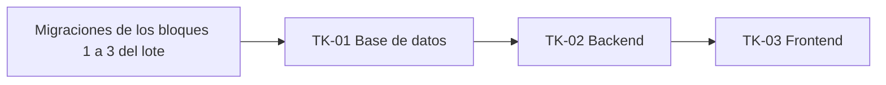

# 6. Tickets de Trabajo

> Son 3 tickets (base de datos, backend y frontend) que forman el **corte vertical de HU-CC-01**: registrar un cargo con cálculo de tarifa y descuento. Se eligió esa historia porque concentra las reglas de negocio, y por eso es la que mejor se ve partida en capas.
>
> **Referencias:**
> - historia y criterios: [`5-historias-de-usuario.md`](5-historias-de-usuario.md), Historia de Usuario 3;
> - tablas: [`3-modelo-de-datos.md`](3-modelo-de-datos.md);
> - endpoint: [`4-especificaciones-de-la-api.md`](4-especificaciones-de-la-api.md);
> - stack: [`docs/architecture/documento-tecnico.md`](docs/architecture/documento-tecnico.md).
>
> Como no se usa gestor de tickets, estos tickets son las unidades de trabajo (documento técnico, «Gestión del trabajo»).

## Orden y dependencias

| Ticket | Capa | Depende de | Estimación |
|---|---|---|---|
| TK-01 | Base de datos | Migraciones de los bloques 1 a 3 del lote | 4 h |
| TK-02 | Backend | TK-01 | 10 h |
| TK-03 | Frontend | TK-02 | 8 h |

**Total: 22 h.** Las estimaciones son en horas de una persona, e incluyen los tests y la revisión.

---

**Ticket 1**

## TK-01 · Base de datos: tarifario y cargo

| | |
|---|---|
| **Tipo** | Base de datos |
| **Historia** | HU-CC-01 (incluye el cálculo de HU-TAR-04). Las tablas del tarifario son las de HU-TAR-01 a HU-TAR-03. |
| **Estimación** | 4 h |
| **Depende de** | Las migraciones de los bloques 1 a 3 del lote, que crean `usuario`, `temporada`, `grupo`, `familia`, `alumno` e `inscripcion`, y los tipos `turno` y `categoria_familia`. |
| **Bloquea a** | TK-02 |

### Descripción

Crear con Alembic las tablas que necesita el cargo, con los constraints que sostienen las reglas de negocio en la base y no solo en la API.

- **Tablas:** `tarifa_base`, `descuento_modalidad`, `descuento_mes`, `periodo_cobro`, `tipo_cargo` y `cargo`.
- **Tipos enumerados nuevos:** `modalidad` (`mes`, `quincena`, `semana`, `dia`) y `calculo_cargo` (`monto_fijo`, `tarifario`).
- **Además, `pago` y la vista `v_cuenta_corriente`.** La respuesta de `POST /api/v1/cargos` devuelve `saldo_pendiente`, que sale de esa vista, y la vista necesita la tabla `pago`. `pago` se crea con su estructura del modelo, pero su endpoint es de HU-CC-02 y no entra en este corte. Hay que crearla acá y no en una migración posterior, porque `pago` tiene una FK a `cargo` y la vista tiene que existir para TK-02.

### Criterios de aceptación técnicos

**Migración**
- [ ] Hay una revisión de Alembic que crea todo lo anterior. `alembic upgrade head` corre sin errores sobre una base que tiene las migraciones previas del lote.
- [ ] `alembic downgrade -1` deja la base como estaba: borra la vista, las tablas en orden inverso y los tipos `modalidad` y `calculo_cargo`.
- [ ] Los modelos de SQLAlchemy 2 coinciden con la migración: `alembic revision --autogenerate` posterior no detecta diferencias.

**Constraints del tarifario** (ver `3-modelo-de-datos.md`, «Tarifario»)
- [ ] `tarifa_base`: la PK es `(temporada_id, turno, modalidad)`, y `CHECK (monto > 0)`.
- [ ] `descuento_modalidad`: la PK es `(temporada_id, categoria, modalidad)`, y `CHECK (modalidad <> 'mes')`.
- [ ] `descuento_mes`: la PK es `(temporada_id, categoria, tramo_hijos)`, y `CHECK (tramo_hijos BETWEEN 1 AND 4)`.
- [ ] En las dos tablas de descuento, `porcentaje` es `numeric(5,2)` con `CHECK (porcentaje BETWEEN 0 AND 100)`.
- [ ] `periodo_cobro` tiene:
  - `CHECK (modalidad <> 'dia')` y `CHECK (fecha_desde <= fecha_hasta)`;
  - `UNIQUE (temporada_id, modalidad, nombre)`;
  - `UNIQUE (id, modalidad)`, que es la clave a la que apunta la FK compuesta de `cargo`.
- [ ] `tipo_cargo` tiene `UNIQUE (temporada_id, nombre)` y `CHECK ((calculo = 'monto_fijo') = (monto_fijo IS NOT NULL))`.

**Constraints de `cargo`** (ver `3-modelo-de-datos.md`, «Cuenta corriente familiar»)
- [ ] **El total coincide con la base y el porcentaje:** `CHECK (monto_total = round(monto_base * (1 - porcentaje_aplicado / 100), 2))`.
- [ ] **El período es de la misma modalidad que el cargo:** hay una FK compuesta `(periodo_cobro_id, modalidad)` → `periodo_cobro (id, modalidad)`, con `MATCH SIMPLE`. Si alguna de las dos columnas es NULL, la FK no se evalúa. Eso es lo correcto para la Preinscripción, que no tiene modalidad ni período, y para el Día, que no tiene período.
- [ ] **La forma del cargo es coherente con la modalidad:**
  - `(modalidad IS NULL) = (inscripcion_id IS NULL)`;
  - si `modalidad = 'dia'`, `fecha_dia` es NOT NULL y `periodo_cobro_id` es NULL;
  - si la modalidad es `mes`, `quincena` o `semana`, `periodo_cobro_id` es NOT NULL y `fecha_dia` es NULL;
  - `(cantidad_hijos_aplicada IS NOT NULL) = (modalidad = 'mes')`, con `cantidad_hijos_aplicada >= 1`.
- [ ] `porcentaje_aplicado` tiene `CHECK` entre 0 y 100.
- [ ] Hay un índice en `cargo (familia_id, temporada_id)`, que es el filtro de `v_cuenta_corriente`.
- [ ] Ninguna FK usa `ON DELETE CASCADE`, porque en el sistema nada se borra.

**`pago` y la vista**
- [ ] `pago` tiene las columnas y los `CHECK` del modelo, incluidas las de anulación, como nullable. El `CHECK` exige que motivo, usuario y fecha de anulación estén completos o vacíos a la vez.
- [ ] `v_cuenta_corriente` expone `familia_id`, `temporada_id`, `total_cargos`, `total_pagos` y `saldo_pendiente`. Los pagos anulados no cuentan. Una familia con cargos y sin pagos tiene `total_pagos = 0`, no NULL.

**Tests (pytest, contra PostgreSQL real, no SQLite).** Usar PostgreSQL porque SQLite no evalúa igual los `CHECK` ni las FK compuestas. Cada test inserta una fila inválida y espera `IntegrityError`:
- [ ] un `cargo` con `monto_total` que no coincide con la base y el porcentaje;
- [ ] un `cargo` con modalidad `mes` apuntando a un `periodo_cobro` de modalidad `semana`;
- [ ] un `descuento_modalidad` con modalidad `mes`;
- [ ] un `descuento_mes` con tramo 5;
- [ ] un `cargo` de modalidad `dia` sin `fecha_dia`.

Un test adicional comprueba que `v_cuenta_corriente` devuelve 85000.00 para una familia con un cargo de 85000.00 y sin pagos.

### Referencias

- **Historia:** HU-CC-01, en `5-historias-de-usuario.md` (Historia de Usuario 3) y en `docs/product/historias-backlog.md`.
- **Tablas:** `3-modelo-de-datos.md`, entidades `tarifa_base`, `descuento_modalidad`, `descuento_mes`, `periodo_cobro`, `tipo_cargo`, `cargo` y `pago`, y la vista `v_cuenta_corriente`.
- **Reglas:** Acl. 5 (tarifa, descuentos y tipos de cargo) y Acl. 6 (anulaciones), en `docs/prd/aclaraciones-cliente.md`.

---

**Ticket 2**

## TK-02 · Backend: `POST /api/v1/cargos` con el motor de cálculo

| | |
|---|---|
| **Tipo** | Backend |
| **Historia** | HU-CC-01 (incluye HU-TAR-04) |
| **Estimación** | 10 h |
| **Depende de** | TK-01. También necesita la autenticación JWT y la dependencia de roles del bloque 1 del lote (HU-UT-01). |
| **Bloquea a** | TK-03 |

### Descripción

Implementar `POST /api/v1/cargos` tal como está especificado en `4-especificaciones-de-la-api.md`, incluido `simular=true`. El cliente solo dice **qué** se cobra. La API resuelve la familia, la categoría, la cantidad de hijos, la tarifa y el porcentaje, calcula el monto y lo guarda congelado en el cargo.

**Estructura:**
- **Router** en `app/api/v1/cargos.py`. Declara el rol con una dependencia de FastAPI (`require_rol("admin")`), como pide el documento técnico.
- **Esquemas Pydantic:** `CargoCreate`, `CargoCalculo`, `Cargo` y `CargoRegistrado`, con los mismos nombres y campos que la especificación.
- **Motor de cálculo** en `app/services/calculo_cargo.py`. Es una **función pura**: recibe los datos ya resueltos (tipo de cargo, tarifa base, categoría, modalidad, cantidad de hijos y porcentajes) y devuelve `monto_base`, `porcentaje_aplicado` y `monto_total`. No toca la base, y por eso se puede testear con tablas de casos.
- **Servicio** en `app/services/cargos.py`. Resuelve los datos desde la base, llama al motor e inserta el cargo. Con `simular=true` no inserta nada.

### Criterios de aceptación técnicos

**Cálculo**
- [ ] **Preinscripción** (`calculo = 'monto_fijo'`): `monto_base` es `tipo_cargo.monto_fijo` y `porcentaje_aplicado` es 0, para cualquier categoría.
- [ ] **Abono:**
  - `monto_base` sale de `tarifa_base` (temporada, turno de la inscripción, modalidad);
  - el porcentaje sale de `descuento_mes` (categoría y `min(hijos, 4)`) si la modalidad es Mes, o de `descuento_modalidad` en los demás casos;
  - se aplica **un solo** porcentaje, nunca acumulado.
- [ ] **Cantidad de hijos** (solo en el Mes): son las inscripciones de alumnos de la familia en la misma temporada y turno, contadas **al momento del cargo**. Queda guardada en `cantidad_hijos_aplicada`.
- [ ] **Redondeo:** `monto_total` usa `Decimal` con `ROUND_HALF_UP` a 2 decimales. Es el mismo redondeo que `round()` de PostgreSQL sobre `numeric`, así que el `CHECK` de TK-01 nunca rechaza un cargo que calculó la API. Nada se calcula con `float`.
- [ ] `categoria_aplicada` y `cantidad_hijos_aplicada` se guardan con el valor del momento. Los cargos ya registrados no se recalculan.

**Endpoint**
- [ ] Sin `simular`: inserta el cargo y responde `201` con `CargoRegistrado`. `saldo_pendiente` se lee de `v_cuenta_corriente` en la misma transacción, después del insert.
- [ ] Con `simular=true`: responde `200` con `CargoCalculo` y no escribe nada en la base.
- [ ] Los errores son los de la especificación:
  - `403` si quien lo usa no es Admin;
  - `404` si no existe el alumno, el tipo de cargo, la inscripción o el período;
  - `409` si la temporada está cerrada o falta la tarifa base o el porcentaje;
  - `422` si los campos no tienen la forma del tipo de cargo, si el período es de otra modalidad o si la inscripción no es del alumno.

  Todos los mensajes van en español.
- [ ] La API valida la forma del cargo antes de llegar a la base. Los `CHECK` de TK-01 son la última defensa, no el mecanismo de validación: un `IntegrityError` nunca llega al cliente como `500`.

**Tests (pytest).** El motor se prueba con tests unitarios parametrizados, sin base. El endpoint se prueba con tests de integración, usando el cliente de pruebas de FastAPI contra PostgreSQL. Los datos de ejemplo son los del contexto común de HU-CC-01: tarifa Mes mañana $ 100.000; socio 50 %; empleado 10/15/20/25 % en el Mes y 10 % en Día, Semana y Quincena; no socio 0/10/15/20 % en el Mes. Casos mínimos:

| # | Caso | Esperado |
|---|---|---|
| 1 | Socio, 1 hijo, Abono · Mes, mañana | 50 % → `monto_total` 50000.00 |
| 2 | No socio, 3 hijos, Abono · Mes, mañana | 15 % → 85000.00, `cantidad_hijos_aplicada` 3 |
| 3 | Empleado, 3 hijos, Abono · Día, mañana ($ 8.000) | 10 %: la cantidad de hijos no interviene → 7200.00, `cantidad_hijos_aplicada` null |
| 4 | Tramo 4 o más, aplicado a todos: no socio con 4 hijos, un Abono · Mes para cada uno | Los 4 cargos son de 80000.00 (20 %), incluido el del primer hijo. Con 5 hijos también se usa el tramo 4. |
| 5 | Rechazo por rol: Coordinador y Profesor | `403`, y la tabla `cargo` no cambia |
| 6 | Familia inexistente: `alumno_id` que no existe. La familia se deriva del alumno, así que a nivel API es este caso. | `404` |
| 7 | Inscripción inexistente | `404` |

Casos adicionales, que salen de los escenarios de HU-CC-01:

| # | Caso | Esperado |
|---|---|---|
| 8 | Un único %: socio con 4 hijos, Mes | 50 %, no 50 % + 25 % → 50000.00 |
| 9 | Hijos por turno: Juan en mañana y tarde, Ana solo en mañana, empleado | Mañana: 2 hijos → 85000.00. Tarde: 1 hijo, $ 80.000 → 72000.00 |
| 10 | Hijo que se suma a mitad de temporada | El cargo nuevo usa el tramo nuevo, y el cargo anterior no cambia |
| 11 | Preinscripción | 20000.00 con 0 %, igual para las tres categorías |
| 12 | `simular=true` | `200`, el cálculo correcto, y la cantidad de filas de `cargo` no cambia |
| 13 | `saldo_pendiente` | Después de dos cargos de 85000.00 y 27000.00, sin pagos → 112000.00 |
| 14 | Falta la tarifa base de esa combinación | `409` |
| 15 | Temporada cerrada | `409` |
| 16 | Período de otra modalidad, o inscripción de otro alumno | `422` |

### Referencias

- **Historia:** HU-CC-01, escenarios 1 a 11, en `5-historias-de-usuario.md`.
- **Endpoint:** `POST /api/v1/cargos` en `4-especificaciones-de-la-api.md`, con los esquemas `CargoCreate`, `CargoCalculo`, `Cargo` y `CargoRegistrado`.
- **Tablas:** las de TK-01, más `inscripcion`, `alumno`, `familia` y `temporada` del modelo.
- **Reglas:** Acl. 5 y Acl. 9 (solo el Admin registra cargos).
- **Seguridad:** documento técnico, «Permisos». El rol se declara con una dependencia de FastAPI.

---

**Ticket 3**

## TK-03 · Frontend: pantalla de registrar cobro con desglose del cálculo

| | |
|---|---|
| **Tipo** | Frontend |
| **Historia** | HU-CC-01 |
| **Estimación** | 8 h |
| **Depende de** | TK-02. Para llenar los selectores también necesita endpoints de lectura de alumnos con sus inscripciones, tipos de cargo y períodos de cobro. Esos endpoints no están entre los 3 documentados (límite de la entrega); hay que acordarlos con TK-02 o con el ticket de lectura que corresponda del lote. |
| **Bloquea a** | — |

### Descripción

Pantalla en React + Vite donde el Admin registra un cargo a una familia. El PRD la llama "pantalla de registrar el cobro". En el vocabulario del sistema, lo que se registra acá es el **cargo**; el pago es HU-CC-02.

Antes de confirmar, la pantalla muestra el **desglose del cálculo** con `POST /api/v1/cargos?simular=true`: tarifa base, categoría, cantidad de hijos (en el Mes), porcentaje aplicado y total. **El frontend nunca calcula ni envía montos**: solo manda qué se cobra, y muestra lo que devuelve la API.

### Criterios de aceptación técnicos

**Acceso**
- [ ] La ruta y la opción de menú solo aparecen para el rol Admin. Si la API responde `403`, la pantalla lo informa y no muestra datos. Esto es solo comodidad: el control real está en la API (documento técnico).

**Formulario** (los campos son los de `CargoCreate`)
- [ ] Alumno: se elige, y se muestra la etiqueta de su familia.
- [ ] Tipo de cargo.
- [ ] Si el tipo de cargo es Abono, aparecen inscripción (turno) y modalidad. Además:
  - con Mes, Quincena o Semana, aparece el período de cobro, filtrado por esa modalidad;
  - con Día, aparece la fecha.
- [ ] Si el tipo de cargo es Preinscripción, se ocultan inscripción, modalidad, período y fecha, y el cuerpo no los envía.

**Simulación y confirmación**
- [ ] Cuando el formulario está completo y válido, se llama a la simulación. Si el usuario cambia un campo, se vuelve a llamar, con un retardo para no disparar un pedido por cada tecla.
- [ ] El desglose muestra:
  - `monto_base`;
  - `categoria_aplicada`;
  - `cantidad_hijos_aplicada`, solo en el Mes;
  - `porcentaje_aplicado`;
  - `monto_total`.

  Los montos se muestran con formato de pesos argentinos. Se usan los strings `Decimal` de la API tal como llegan, sin convertirlos a `float` para calcular nada.
- [ ] El botón **Confirmar** solo se habilita con una simulación válida y vigente para los valores actuales del formulario.
- [ ] Al confirmar se envía el mismo cuerpo sin `simular`. Con `201`, se muestran el cargo registrado y el `saldo_pendiente` de la familia. Si el total registrado difiere del simulado (por ejemplo, porque el Admin cambió la tarifa en el medio), se muestra el registrado y se avisa.
- [ ] El botón se deshabilita mientras el pedido está en curso, para no registrar dos veces el mismo cargo.

**Errores**
- [ ] `409` por tarifa o porcentaje faltante: mensaje claro que indica qué combinación falta, sin desglose.
- [ ] `409` por temporada cerrada: mensaje y formulario deshabilitado.
- [ ] `422`: si `loc` apunta a un campo, el error se muestra junto a ese campo; si no, arriba del formulario.

**Diseño**
- [ ] Usable en celular y PC (Acl. 12), con la librería de componentes que se elija (MUI o Mantine, pendiente en el documento técnico).
- [ ] No se muestra la asistencia (Acl. 5).

**Verificación**
- [ ] Recorrida manual de los escenarios 1, 2, 7, 9 y 11 de HU-CC-01 contra la API de TK-02, en celular y en PC. El documento técnico no define tests automatizados de frontend; si se suman, se agregan a este ticket.

### Referencias

- **Historia:** HU-CC-01, escenario 1 (desglose y saldo), escenarios 9 y 10 (errores 409) y escenario 11 (solo Admin), en `5-historias-de-usuario.md`.
- **Endpoint:** `POST /api/v1/cargos` y `POST /api/v1/cargos?simular=true` en `4-especificaciones-de-la-api.md` (ver «Concesiones por el límite de 3 endpoints»).
- **Tablas:** solo a través de la API. Los campos mostrados son los de `cargo` y `v_cuenta_corriente.saldo_pendiente` en `3-modelo-de-datos.md`.
- **Stack:** documento técnico, «Stack» (React + Vite, MUI o Mantine).
